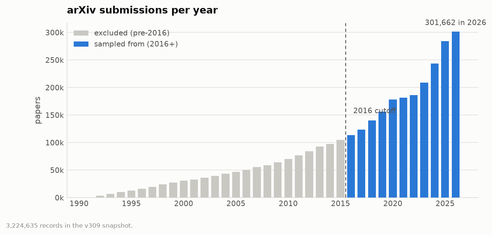
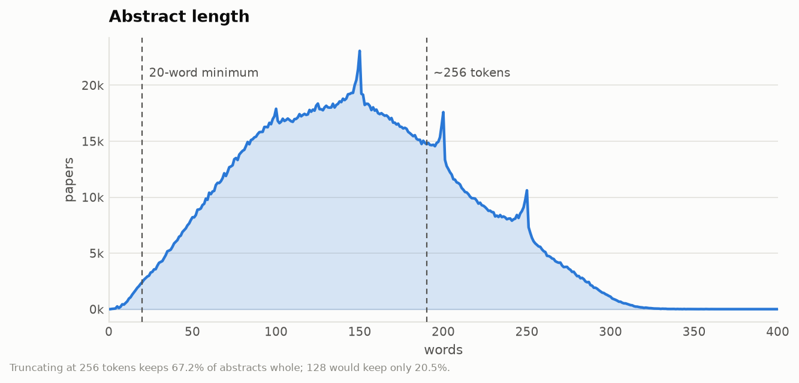
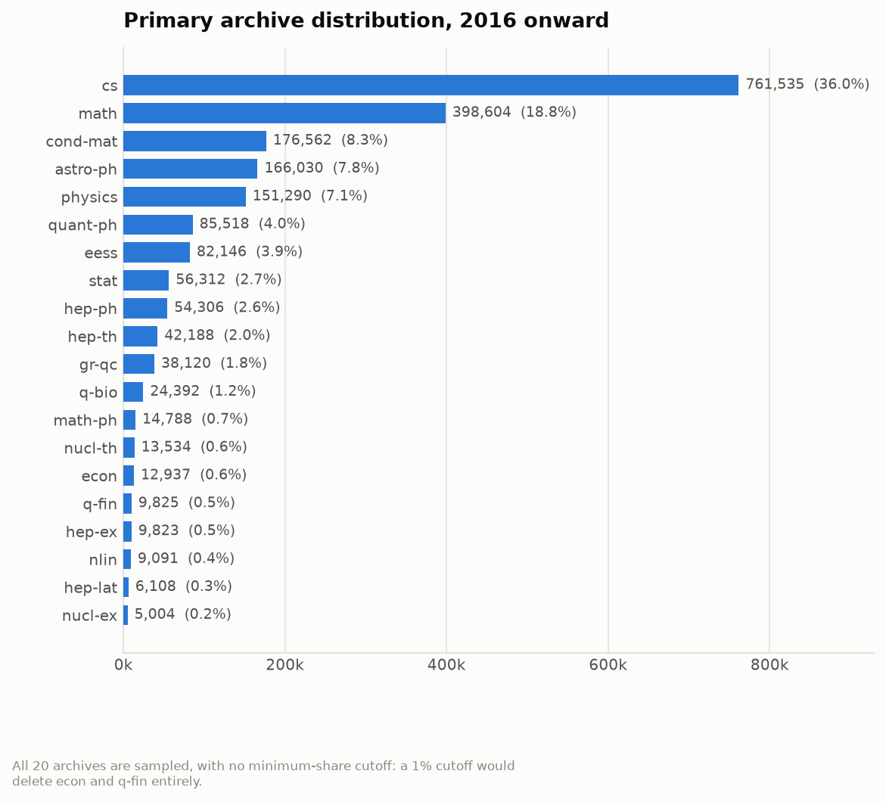
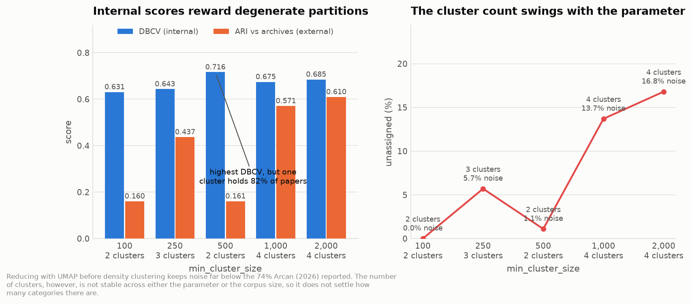
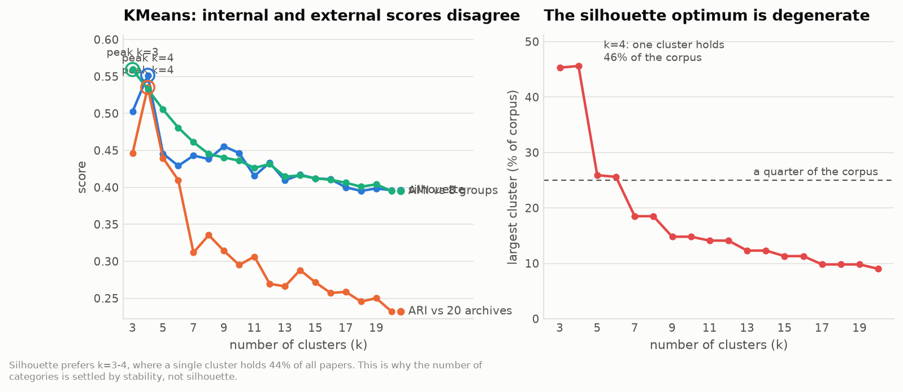
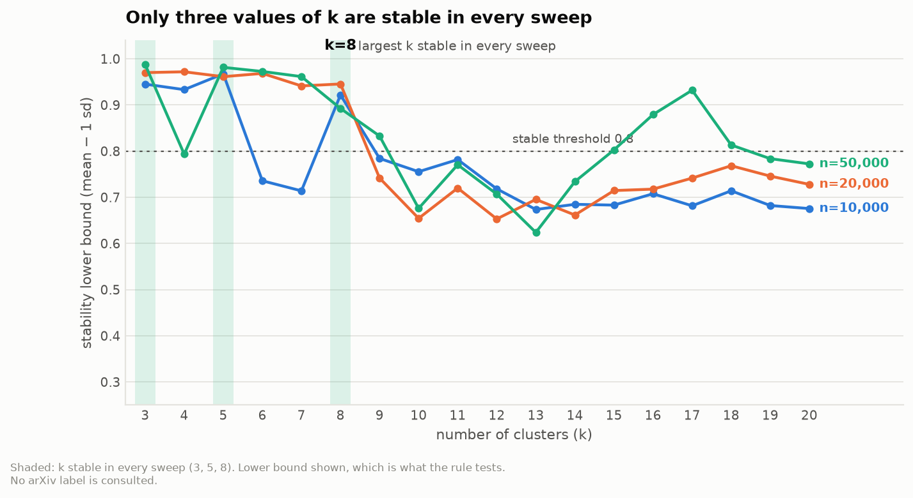
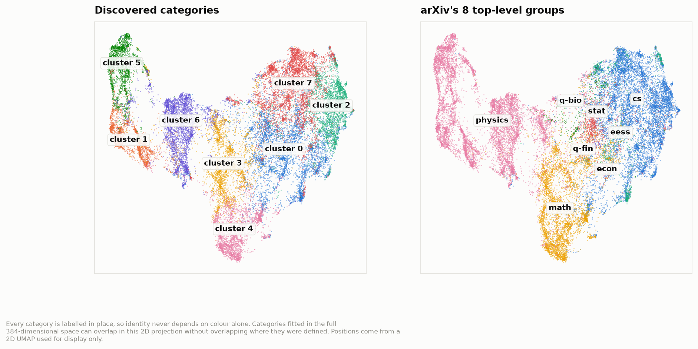
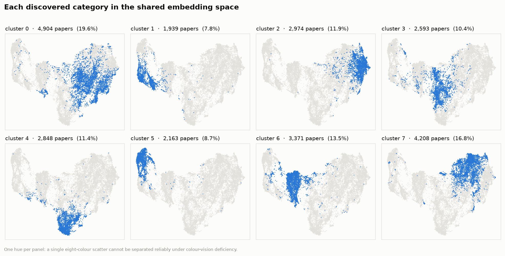
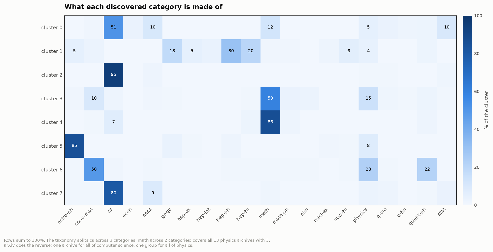
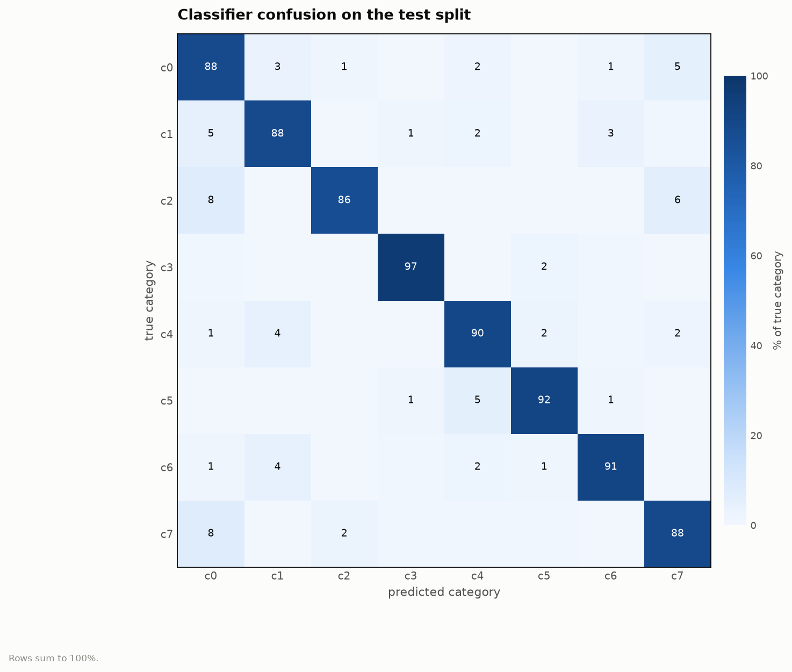

# Research Article Classification — arXiv

Sorting research papers into categories using only their abstracts, when nobody tells us how many
categories there should be. Data: the public
[arXiv dataset](https://www.kaggle.com/datasets/Cornell-University/arxiv) from Cornell University
(one file, 5.65 GB, about 2.7 million papers).

---

# 1. Literature Review and Methodological Rationale

## 1.1 What the problem actually is

The task sounds like ordinary text classification, but it is not. In ordinary classification you
are given a list of categories and you train a model to pick one. Here the number of categories is
unknown, and finding the right number is part of the job.

That makes this two problems in one:

- **An open question:** how many categories are there, and what are they?
- **A normal machine-learning question:** can a model read a new abstract and assign it to a
  category?

The arXiv data does come with its own subject labels, like `cs.LG` or `math.PR`. These are useful,
but we should not treat them as the single correct answer, for two reasons. First, authors choose
their own labels, so they are inconsistent. Second, most papers carry several labels at once, so
there is no single "true" category per paper.

We therefore split the work into four parts and study each one separately:

1. **Representation** — how do we turn an abstract into numbers a computer can compare?
2. **Discovery** — how do we find natural groups of papers without deciding the groups in advance?
3. **Choosing the number of groups** — how do we pick a number and defend it?
4. **Classification** — how do we train a Hugging Face model to label new, unseen abstracts?

Splitting it this way means each decision gets tested on its own, instead of guessing a whole
pipeline up front and hoping it works.

## 1.2 What the literature says

We read the relevant work before choosing a method. Here is what we found and what we took from
each paper.

### The closest existing study

**Arcan (2026), [arXiv:2601.08841](https://arxiv.org/abs/2601.08841)** — *Triples and
Knowledge-Infused Embeddings for Clustering and Classification of Scientific Documents.*

This paper does almost exactly our task: it clusters arXiv papers **and** trains classifiers to
predict arXiv subjects. It compares four ways of representing a paper, four embedding models
(MiniLM, MPNet, SciBERT, SPECTER) and three clustering algorithms (KMeans, GMM, HDBSCAN).

Two findings matter a lot for us:

- Plain abstract text worked **better** than fancier representations that added structured
  knowledge. Simpler was stronger.
- General-purpose sentence models (MiniLM, MPNet) beat the science-specific models (SciBERT,
  SPECTER) at clustering, even though the science-specific ones were trained on research papers.

It reports about **0.923 accuracy and 0.923 macro-F1** for abstract-only classification, averaged
over five runs.

**What we take from it:** do not assume the specialised, expensive option is better. Test it. We
also treat the 0.923 figure carefully — it was measured on a *filtered* subset of arXiv, and we do
not yet know how many categories that involved. A score on 6 categories cannot be compared to a
score on 8 or 150, so we use it as a reference point, not as a target to hit.

### Turning text into numbers

**Reimers & Gurevych (2019), [arXiv:1908.10084](https://arxiv.org/abs/1908.10084)** —
*Sentence-BERT.*

Plain BERT is not built for comparing whole texts. If you feed it two abstracts and compare the
output, the results are poor, because BERT was never trained to make similar texts land near each
other. Sentence-BERT fixes this by training specifically for similarity.

**Singh et al. (2023), [arXiv:2211.13308](https://arxiv.org/abs/2211.13308)** — *SciRepEval*, the
benchmark behind SPECTER2.

Tested scientific document embeddings across 24 tasks and found that the best representation
depends on the kind of task. One embedding is not best at everything.

**What we take from these:** use a model built for similarity, not raw BERT. And since no single
embedding wins everywhere, compare a few rather than picking one on reputation.

### Finding groups without fixing the number

**Grootendorst (2022), [arXiv:2203.05794](https://arxiv.org/abs/2203.05794)** — *BERTopic.*

A four-step recipe: turn documents into vectors, squash those vectors down to fewer dimensions
(UMAP), group them (HDBSCAN), then describe each group by the words that make it distinctive
(class-based TF-IDF). The appeal is that HDBSCAN finds the number of groups by itself and can mark
odd documents as outliers instead of forcing them somewhere.

**What we take from it:** this is our main discovery method, and the word-based descriptions are how
we make clusters readable by a human.

**One important warning.** Published work using this approach shows it tends to break data into far
too many groups. Reported topic counts average around 67 where older methods find 15–22 on the same
data. In one reported case it produced **3,561 topics on data that humans had labelled with 4**, and
in several datasets **more than half of all documents were dumped into the outlier bin**.

So we will not simply run HDBSCAN and announce whatever number it returns. That number depends
heavily on its settings. We treat it as one piece of evidence and always report what fraction of
papers were left as outliers.

### Deciding how many groups is right

**Lange, Roth, Braun & Buhmann (2004)**, *Stability-Based Validation of Clustering Solutions*,
Neural Computation 16(6):1299–1323.

The idea is simple and strong. If a grouping reflects something real in the data, you should get
roughly the same grouping from a different sample of that data. If it is an accident of the
algorithm, it will come out differently each time. So: take a random part of the data, group it,
repeat, and measure how much the groupings agree.

**What we take from it:** this is our main tool for choosing the number of categories. Standard
geometric scores like silhouette tend to favour whatever number happens to look tidy; stability asks
the better question, which is whether the grouping is *reproducible*.

### Earlier work on this dataset

**Scharpf et al. (2020), [arXiv:2005.11021](https://arxiv.org/abs/2005.11021)** — JCDL.

An early study of classifying and clustering arXiv content, including how to handle mathematical
notation. It used pre-transformer methods (doc2vec, TF-IDF) on 4,900 documents and reached 82.8%
classification accuracy and 69.4% cluster purity.

**What we take from it:** mainly historical context and a baseline to beat. We are not implementing
its methods, so it informs the problem rather than the solution.

### Our top three

The brief asks for three papers referencing the implementation we will use. Our picks, and why:

| # | Paper | Why |
|---|---|---|
| 1 | **Arcan (2026)** | Closest published version of this exact task; sets our representation and classification choices |
| 2 | **Grootendorst (2022)** — BERTopic | The category-discovery method we implement |
| 3 | **Lange et al. (2004)** | Answers the assignment's central question: how to choose the number of categories |

Supporting references: Sentence-BERT and SciRepEval/SPECTER2 for why we use a similarity-trained
encoder and why we compare two rather than trusting one,
SciBERT and BERT for the classifier, Scharpf et al. for problem history.

### The main conclusion from reading all this

We should not start by committing to one embedding model, one clustering algorithm, or one number of
categories. The literature disagrees with itself on all three, and the paper closest to our task
found that the *simpler* option won. So we write down testable predictions and run a controlled
comparison instead of trusting reputation.

## 1.3 What we are being asked to predict

The brief can be read two ways, so we asked rather than guessed. Iris.ai confirmed the
second reading:

> "You're right, (b) is the better interpretation. Discovering meaningful categories is an
> important part of the objective, but we leave the exact methodology up to you."

So the task is settled:

- The categories are **discovered from the abstracts**. Their number is an output, not an input.
- The classifier predicts **those discovered categories**, not arXiv's subject labels.
- arXiv's own labels are used **only** to interpret and sanity-check what we found. They never
  influence how many categories we report.

This last point is the one that drives the whole design, so it is worth stating plainly: using
arXiv labels to choose the number of categories would be circular. It answers an "unknown number"
question with the known answer. Arcan (2026) does exactly this — it picks the number of clusters by
maximising `0.5·ARI + 0.5·NMI` against the true labels, and the paper itself concedes this "may
inflate reported ARI/NMI". We do not repeat it.

### Three questions, three separate instruments

The central methodological risk here is mixing up two different questions and answering both with
one number. We keep them apart:

| Question | Instrument | What it may **not** be used for |
|---|---|---|
| How many categories are there? | Stability across resamples; DBCV / silhouette | Never uses arXiv labels |
| What are those categories about? | c-TF-IDF terms, nearest-centroid abstracts, composition against arXiv | Not a score |
| Can a model assign a new abstract? | Macro-F1 on a held-out split | Only comparable within one label set |

In particular, **a classifier's macro-F1 is not evidence that a taxonomy is good.** Two classifiers
trained on different label sets cannot be ranked against each other: a trivial 2-category split
would score near-perfectly and tell us nothing. Taxonomy quality and classifier quality are
measured separately, by different tools, and we never trade one against the other.

## 1.4 The pipeline we actually ran

Eight stages, each a script that caches its output so the next one can be re-run without redoing
the work.

| # | Stage | Script | What it produces |
|---|---|---|---|
| 1 | Scan the snapshot | `eda_scan.py`, `eda_year_mix.py` | Corpus statistics, year × archive mix |
| 2 | Sample and split | `preprocess.py` | 150,000 abstracts, fixed 70/15/15 split |
| 3 | Embed | `embed.py` | Frozen sentence embeddings, L2-normalised |
| 4 | Reduce and sweep | `cluster.py` | UMAP to 50d; KMeans k=3..20 and HDBSCAN scored |
| 5 | **Choose the number** | `stability.py` | Stability curve against a structureless null |
| 6 | Interpret | `interpret.py` | Per-category terms, examples, arXiv composition |
| 7 | Classify | `baseline.py`, `train_classifier.py` | Baselines and a fine-tuned BERT |
| 8 | Tune | `tune.py`, `notebooks/colab_train.ipynb` | Staged search over 13 configurations |

Four decisions inside that pipeline are worth justifying, because each is a place where the obvious
choice is wrong.

**The encoder is frozen; nothing is trained to produce embeddings.** Every study we reviewed uses
off-the-shelf sentence embeddings for scientific-document clustering. Fine-tuning an encoder to
improve clustering is a separate research problem, and Arcan's evidence suggests it would not help:
the two science-specific models (SciBERT, SPECTER) lost to the two general-purpose ones (MPNet,
MiniLM) on this exact task. We therefore compare MiniLM and MPNet and skip the specialised pair.

**Only the abstract is encoded — no title.** The brief specifies abstracts, and Arcan found
abstract-only input beat every richer variant they tried.

**UMAP reduction comes before density clustering.** Density estimates degrade badly in high
dimensions. Arcan ran HDBSCAN on raw embeddings and it collapsed to 3–5 clusters with up to 74% of
papers marked as noise, which led them to conclude HDBSCAN was the worst of their three algorithms.
We treat that as a fixable artefact rather than a property of the algorithm, and §4 reports what
happens when it is fixed.

**But the number of categories is *not* decided in UMAP space.** UMAP with `min_dist=0.0`
deliberately manufactures tightly separated clumps. Measured inside that space, every internal
criterion saturates — our stability score is 1.000 at k=3 and falls monotonically, which would
simply reproduce the degenerate answer. That measures UMAP's determinism, not structure in the
data. So the reduction is used where it is needed (density clustering) and the number of categories
is settled in the original embedding space.

### Keeping the scope realistic

The full dataset is 2.7 million papers and the full hyperparameter grid is 108 training runs.
Neither is necessary, and we cut both deliberately:

- One fixed stratified sample of 150,000 abstracts, drawn once and committed as a list of arXiv IDs
- A 10,000-paper pilot, drawn as a subsample of the main sample, to validate every step cheaply
- Embeddings computed once and cached
- A staged hyperparameter search — learning rate, then batch size, then encoder, then seeds —
  which costs 10 distinct runs instead of 108

## 1.5 What we expect to find

Written as predictions we can be wrong about, and scored honestly in §7.

- **H1** — Silhouette and stability will disagree about the number of categories. Where they do, we
  prefer stability and say so.
- **H2** — HDBSCAN *after* UMAP reduction will not show the collapse Arcan reported, and will leave
  far less than 74% of papers as noise.
- **H3** — The discovered categories will not line up with arXiv's 8 groups. We expect them to
  merge several non-physics groups and split physics, because arXiv's taxonomy reflects community
  history while abstracts cluster by shared method and vocabulary.
- **H4** — Our two reference levels will peak at different numbers of clusters: the 8 groups will
  favour fewer categories, the 20 archives more.
- **H5** — A fine-tuned BERT will beat a TF-IDF + LinearSVC baseline on macro-F1. If it does not,
  that is a finding about how lexically separable the discovered categories are, not a bug.

### How we score things, and why

We report **macro-F1**, not accuracy. The categories are very unbalanced, and accuracy hides this
completely. Published results on arXiv's 8 top-level classes show the problem:

| Model | Accuracy | Macro-F1 |
|---|---|---|
| Naive Bayes (TF-IDF) | 0.89 | 0.65 |
| LinearSVC (TF-IDF) | 0.82 | 0.82 |

Naive Bayes looks better on accuracy and is much worse in reality: it does well on the big classes
and poorly on the small ones. Our own majority-class baseline makes the same point more sharply —
see §5.

For comparing groupings we use **AMI and ARI** rather than raw NMI. Raw NMI drifts upward as the
number of clusters grows, which would unfairly reward splitting the data further. AMI and ARI
correct for chance (Vinh, Epps & Bailey, JMLR 2010).

For density-based clustering we use **DBCV** rather than silhouette. Silhouette assumes convex,
roughly spherical clusters, which is exactly the assumption HDBSCAN is built to avoid, so applying
it to HDBSCAN output would penalise the algorithm for working as intended.

## 1.6 What this study contributes

A reproducible, literature-informed comparison of ways to represent and group scientific abstracts.
We report a number of categories together with the criteria that justify it, show how those
categories relate to arXiv's existing taxonomy, and measure how well a transformer classifier
generalises to unseen abstracts.

We also document the limits. Category granularity is genuinely ambiguous, scientific fields overlap,
and discovered clusters are not the same kind of object as human-assigned subject labels. Where our
evidence does not settle a question, we say so rather than picking the flattering number.

> **Reading this report.** Sections 1.2–1.5 were written before the experiments and state
> what the literature suggested and what we expected to find. Everything from §2 onward
> reports what actually happened. §7.3 scores the predictions against the results, and
> §7.4 records the four places our own method was wrong and had to be fixed — including,
> twice, a conclusion we had already written down.

---

## 2. Exploratory data analysis

`src/eda_scan.py` streams the 5.65 GB snapshot once and never loads it into memory.
`src/eda_year_mix.py` adds the year × subject cross-tabs. Both write JSON to `reports/`.

**Snapshot v309 — 3,224,635 papers.**

| Property | Value | Why it matters |
|---|---|---|
| Papers | 3,224,635 | Pinned to Kaggle version 309 |
| Empty abstracts | 0 | Nothing to impute |
| Abstracts under 20 words | 15,567 | Dropped — too short to carry topical signal |
| Median abstract length | 145 words | 256 wordpiece tokens fits 67.2% whole; 128 would fit 20.5% |
| Papers with >1 subject label | 48.3% | **There is no single "true" category per paper** |
| Mean labels per paper | 1.74 (max 13) | |
| Papers spanning >1 top-level group | 558,087 (17.3%) | Overlap is not just within a field |
| Distinct archives | 38 (20 still active from 2016) | 18 are legacy archives, retired before 2016 |





Three findings shaped the rest of the work.

**Nearly half of all papers carry more than one label.** This is the single most important fact in
the dataset. It means arXiv's labels cannot serve as ground truth for a single-label task — there
is no one right answer to compare against. It is a large part of why we treat the arXiv taxonomy as
a measuring stick for interpretation rather than as a target.

**The subject mix shifts sharply over time.** Computer science was a minor archive in the 1990s and
is now the largest. A sample drawn across all years would be a sample of arXiv's *history*, and the
categories we discovered would partly reflect how the archive's composition changed rather than how
research topics differ. We therefore restrict to **2016 onward** (2,118,113 papers), which also
removes all 18 legacy archives cleanly and leaves 20 active ones.



**Class imbalance is extreme and we keep it.** In the drawn sample the largest archive (`cs`) has
53,930 papers and the smallest (`nucl-ex`) has 354 — a ratio of roughly 150:1. Rebalancing would
make the number of discovered categories an artefact of our sampling, so the real proportions are
preserved and the imbalance is handled later, in the classifier's loss function.

### A decision worth recording: no minimum-share cutoff

An earlier version of this work kept only the 14 archives above a 1% share, which covered 96.5% of
papers. Recomputing on 2016+ data showed the cutoff would keep only 12 archives and **delete `econ`
and `q-fin` entirely**. Since one of the questions is whether the discovered categories match
arXiv's, silently removing two of them would have prejudged the answer. All 20 active archives are
sampled, with no cutoff.

## 3. Preprocessing

`src/preprocess.py` makes one streaming pass and writes a fixed sample, a fixed split, and a
committed list of arXiv IDs.

### Filters

| Filter | Effect |
|---|---|
| Submitted 2016 or later | 3,224,635 → 2,118,113 |
| Abstract of at least 20 words | → 2,113,230 eligible |

### Text cleaning is deliberately minimal

Whitespace is collapsed. **LaTeX is left intact.** Stripping `$\alpha$` or `\nabla` would remove
real topical signal from mathematics and physics abstracts — in §6 the mathematics category is
identified partly by the tokens `mathbb` and `mathcal`. The sentence-transformer tokenisers handle
the markup without help. No stemming, no lowercasing, no stop-word removal: the encoder is
pretrained on natural text and expects it unmodified.

### Stratified sampling, not random sampling

A uniform random draw would leave the rarest archives with too few papers to form a cluster. The
sample is therefore **stratified on the primary archive and proportional**, so every archive is
guaranteed to appear while the real class proportions are preserved. Each archive's rows are drawn
by reservoir sampling (Algorithm R) against a seeded RNG, in the same single pass.

| Phase | Papers | Purpose |
|---|---|---|
| **main** | 150,000 | The reported results |
| **pilot** | 10,000 | A subsample of main; matches Arcan's scale for direct comparison |

The pilot is drawn *from* the main sample and inherits its split assignment, so no paper ever moves
between train and test across phases. Validating every step on the pilot first turned a 90-minute
mistake into a 90-second one several times.

### The split is fixed once, before anything else

| Split | main | pilot |
|---|---|---|
| train | 105,000 | 7,022 |
| validation | 22,499 | 1,544 |
| test | 22,501 | 1,434 |

Stratified 70/15/15 on the primary archive, seeded. Every later step reads this split; none of them
recomputes it.

### Reproducibility

The Kaggle dataset is re-published monthly, so "the arXiv dataset" is not a reproducible object. We
pin **version 309** and commit the sampled arXiv IDs to `data/splits/`, which makes the exact
sample recoverable even after the dataset changes underneath us.

```
data/splits/main_ids.csv.gz     150,000 ids + split + clustering flag
data/splits/pilot_ids.csv.gz     10,000 ids + split + clustering flag
```

Everything else follows from `SEED = 42` in `src/config.py`, which is the only place paths and
constants are defined.

A note on where data lives: the raw snapshot (5.65 GB) and the derived embeddings (230 MB) are
written to `%LOCALAPPDATA%`, **not** into the project folder, which sits inside a synced
OneDrive directory. Only small, traceable artifacts — statistics, metrics, sampled IDs, figures —
are committed.

## 4. Model training

This section covers both models the task needs: the unsupervised one that discovers the
categories, and the supervised one that learns to assign them.

### 4.1 Representation

Abstracts are encoded with a frozen sentence-transformer. Nothing is trained here.

| | |
|---|---|
| Model | `sentence-transformers/all-MiniLM-L6-v2` (384d, max 256 tokens) |
| Input | abstract only, no title |
| Output | L2-normalised float32 |
| Throughput | 150,000 abstracts in 81.7 min on CPU (30.6 rows/s) |

Three choices, each with a reason:

**Frozen, not fine-tuned.** Every study reviewed in §1.2 uses off-the-shelf embeddings for
this task. Fine-tuning an encoder to improve clustering is a separate research problem,
and the one paper that measured it on this exact data found the two *science-specific*
models (SciBERT, SPECTER) lost to the two general-purpose ones.

**Abstract only.** The brief specifies abstracts, and Arcan (2026) found abstract-only
input beat every richer variant they tried.

**L2-normalised.** This makes Euclidean distance and cosine similarity equivalent, which
is what KMeans assumes. Without it, KMeans would be clustering on vector magnitude —
roughly, on how long the abstract is.

### 4.2 Finding candidate groupings

Two algorithms with complementary failure modes are swept, so neither one's assumptions
go unchallenged:

- **KMeans**, k = 3…20, on all 150,000 papers. Assigns every paper; assumes roughly
  convex clusters.
- **HDBSCAN**, `min_cluster_size` from 0.2% to 4% of the corpus. Finds its own number of
  clusters and can refuse to assign a paper.

HDBSCAN is run on a 50-dimensional UMAP reduction, the fix for the failure described in
§1.4. It is also run on a 50,000-paper subsample: on the full sample it reached 16 GB of
paged memory on a 32 GB machine and made no progress in twenty hours. KMeans has no such
problem.

#### The UMAP reduction fixes the noise collapse

Arcan ran HDBSCAN on raw high-dimensional vectors and reported 3–5 clusters with **up to
74% of papers discarded as noise**, concluding that HDBSCAN "performed worst by a wide
margin." With the reduction in place, that collapse does not happen:

| | Arcan (no reduction) | pilot, 10k | main, 50k |
|---|---|---|---|
| Papers left as noise | up to **74%** | 1.0 – 31.4% | **0.0 – 16.8%** |
| Best ARI vs archives | 0.01 – 0.03 | **0.504** | **0.610** |
| Best DBCV | not reported | 0.681 | 0.716 |

Both the noise rate and the agreement with arXiv improve by a large margin, at both
scales, and the best ARI exceeds Arcan's best reported figure of 0.470 — obtained,
unlike theirs, without ever consulting the labels to choose a configuration.



#### But HDBSCAN's cluster count does not survive a change of scale

The pilot alone would have supported a stronger claim. It should not be made. Running the
same `min_cluster_size` *fraction* on the two corpus sizes gives different answers:

| `min_cluster_size` | pilot (10k) | main (50k) |
|---|---|---|
| 0.5% of corpus | **12** clusters | **3** clusters |
| 1% of corpus | **7** clusters | **2** clusters (82% in one) |
| 2% of corpus | 2 clusters | 4 clusters |
| 4% of corpus | 2 clusters | 4 clusters |

The 7-cluster solution that looked so convincing on 10,000 papers does not reappear on
150,000. The count swings with both the parameter and the corpus size, and neighbouring
settings produce degenerate two-cluster partitions in which one cluster holds 82% of the
data.

This is exactly the instability the literature review flagged for this family of methods
(§1.2): reported topic counts that vary wildly on the same data. It means **HDBSCAN
cannot be the instrument that answers "how many categories are there."** What it provides
is a useful independent check on a number chosen some other way, and a demonstration that
the reduction step matters.

So the number is settled by stability instead, and KMeans — whose only free parameter *is*
the number — carries the final taxonomy.

One number is deliberately *not* compared with Arcan: our silhouette scores (0.40–0.59)
dwarf theirs (0.063), but only because ours are measured inside the UMAP reduction, which
compresses clusters by construction. The two figures are not commensurable and no
improvement is claimed there.

### 4.3 Choosing the number of categories

This is the question the brief actually asks, so it gets its own instrument.

#### Why not silhouette



On the 150,000-paper run, silhouette's optimum is **k=4** (0.552) — a solution in which a
single cluster holds **45.6% of the entire corpus**. Silhouette rewards a small number of
well-separated blobs, which is exactly the wrong bias when the question is how finely the
data divides. It is reported, and it decides nothing. (The pilot behaves the same way,
peaking at k=3 with 44.3% in one cluster.)

The two reference levels also disagree, as predicted in H4: ARI against the 20 archives
peaks at k=4, while AMI against the 8 groups peaks at k=3. Coarser reference, coarser
answer. Neither is used for selection — they appear here only to show that no single
external ruler could have settled this either.

#### Stability, and a null that actually works

Stability asks whether a grouping is *reproducible*: cluster two independent 80%
subsamples, measure how much they agree (ARI) on the papers both saw, repeat ten times.

The subtlety is the null. ARI is chance-corrected, so random *labellings* score 0 — but
that is not the relevant comparison, because KMeans will happily carve a featureless blob
the same way twice. The null has to be structureless data of the same shape.

**A first attempt at this failed, and the failure is worth recording.** Shuffling each
embedding coordinate independently preserves every marginal distribution while destroying
the joint structure — a standard trick, and wrong here. UMAP coordinates are strongly
multi-modal, so the product-of-marginals distribution keeps pronounced lumps at the
cross-products of the modes, and KMeans recovers them reproducibly. The "structureless"
null scored **0.9998**. Any margin computed against it measured how fast the null decayed,
not whether real structure existed, and it selected k=16 for no good reason.

The null used instead is **points drawn uniformly on the unit sphere** — the correct shape
for L2-normalised vectors, and genuinely without structure. It scores **0.006–0.014**
across the whole sweep, which is what a null should look like.

#### And a space that actually discriminates

Stability must also be measured somewhere sensible. Inside the UMAP reduction it
saturates: it reaches **1.000 ± 0.000** at k=3, and **17 of the 18** candidate values
clear the threshold, so the rule simply returns whatever the sweep's upper limit happens
to be. `min_dist=0.0` manufactures hard-separated clumps, so what is being measured there
is UMAP's determinism rather than structure in the data. Measured in the embedding space
the same sweep passes only 4 of 18.

The number of categories is therefore decided in the **original embedding space**. UMAP is
used where it is needed — density clustering — and nowhere else.



#### The selection rule

Ben-Hur et al. require scores that are both high *and* concentrated, so the decision is
made on a **one-standard-deviation lower bound** rather than on the mean. This is not a
cosmetic choice: on the pilot, the mean alone selects k=11 (0.849 ± 0.067) over k=8
(0.942 ± 0.020), which inverts the evidence.

**A note on sample size.** The estimator is expensive — ten repetitions × two subsamples
× two data sets (observed and null) × ten KMeans initialisations is 400 clusterings per
candidate k, 7,200 across a sweep — so each sweep runs on a random subsample capped by
`--max-n` rather than on all 150,000. This is the one result in the report not computed
on the full corpus; clustering, interpretation, agreement and baselines all are. Each
sweep's sample size is in its filename and in its `n_papers` field.

#### Three sweeps, and why one is not enough

The sweep was run three times on independent samples — 10,000, 20,000 and 50,000
abstracts. Each produces a curve that looks clean on its own, and **they disagree about
which k are stable**:

| Sweep | k values whose lower bound clears 0.80 |
|---|---|
| pilot, n=10,000 | 3, 4, 5, **8** |
| main, n=20,000 | 3, 4, 5, 6, 7, **8** |
| main, n=50,000 | 3, 5, 6, 7, **8**, 9, 15, 16, 17, 18 |
| **stable in all three** | **3, 5, 8** |

The disagreement is not noise around a common shape — it is structural. The pilot dips
at k=6 and k=7 and recovers at 8. The 20,000-row sweep collapses cleanly from k=9. The
50,000-row sweep collapses at k=10, then **revives** to a lower bound of 0.93 at k=17.

**Two selection rules were tried and both discarded.** Taking the largest k that clears
the threshold anywhere returns **18** on the 50,000-row sweep, walking past the collapse
into a revival that no other sweep reproduces — the same defect this report criticises in
the UMAP-space measurement, where the rule returns whatever the sweep's upper limit
happens to be. Stopping instead at the first sustained collapse returns **5** on the
pilot, because the pilot's genuine dip at k=6–7 reads as a cliff. Neither rule survives
all three sweeps.

#### The rule that does survive: replication

A number of categories is only meaningful if an independent sample of the same corpus
finds it again. That is the premise the whole method rests on, and it applies to the
sweeps themselves, not only to the subsamples inside one sweep.

> **Rule:** take the largest k whose one-standard-deviation lower bound clears 0.80 in
> **every** independent sweep.

This is strictly more conservative than any single-curve rule: it cannot select a k that
any sweep found unstable, and it is indifferent to where a particular curve is ragged.

> **Answer: 8 categories.** Stable in all three sweeps — lower bound 0.922 at n=10,000,
> 0.946 at n=20,000, 0.893 at n=50,000 — against a structureless null of 0.005–0.008
> throughout. Computed in `stability.py --consensus`, recorded in
> `reports/stability_consensus.json`.

Only k=3, k=5 and k=8 clear in all three. Among reproducible taxonomies the more
informative one is preferred — a three-way split is easy to reproduce and tells you
little — so the answer is the largest of them.

**An independent check agrees.** HDBSCAN — a different algorithm, in a different space,
given no k at all — settles on **7** on the pilot.

**What a single sweep would have told us, wrongly.** Reported from the 20,000-row sweep
alone, this section would have claimed a textbook plateau from k=3 to k=8 with a clean
cliff at k=9. That shape is real in that sample and absent in the other two. The selected
number is unchanged, but the evidence for it is replication across samples, not the shape
of one curve — and a single-sweep report would have made a confident claim it could not
support. This is recorded in §7.4.

### 4.4 What the eight categories are

`interpret.py` describes each category three ways — the words that distinguish it
(c-TF-IDF), the papers nearest its centre, and which arXiv archives land in it. Below is
the taxonomy fitted on all 150,000 abstracts.

| # | Share | Reading | Dominant archive | Distinguishing terms |
|---|---|---|---|---|
| 0 | 19.2% | Algorithms, optimisation and control | `cs` (51%) | algorithm, problem, optimization, control |
| 1 | 7.8% | High-energy theory and gravitation | `hep-ph` (30%) | theory, field, black, mass, gravity |
| 2 | 11.9% | **Language models and NLP** | `cs` (**95%**) | models, language, **llms**, reasoning |
| 3 | 10.7% | Differential equations, numerical analysis | `math` (59%) | equation, solutions, numerical, boundary |
| 4 | 11.4% | Pure mathematics and algebra | `math` (86%) | mathbb, mathcal, prove, algebra, graphs |
| 5 | 8.4% | Astrophysics | `astro-ph` (85%) | stars, galaxies, stellar, emission |
| 6 | 13.6% | Condensed matter and quantum systems | `cond-mat` (50%) | quantum, states, magnetic, spin, optical |
| 7 | 17.0% | Machine learning and computer vision | `cs` (80%) | learning, image, training, neural, deep |

Category names are our reading of the evidence, not model output. Every paper is
assigned, and the largest category holds 19.2% of the corpus — no degenerate blob.

The structure also **replicates**: the pilot, drawn fifteen times smaller and clustered
independently, produced the same eight-way split, including a distinct language-models
category at 10.0% versus 11.9% here.





#### The finding: this is not arXiv's taxonomy, and that is the point

Two structural differences, both visible above.

**It splits what arXiv merges.** All of computer science is one arXiv archive. The data
divides it into three categories that share almost no vocabulary: optimisation and
control (0), language models (2), and vision and deep learning (7) — together 48% of the
corpus. Mathematics likewise splits along the applied/pure line into categories 3 and 4.

**It merges what arXiv splits.** arXiv maintains thirteen separate physics archives; the
discovered taxonomy covers all of them with three categories, grouping `hep-ph` with
`hep-th` and `gr-qc` because papers on particle theory, string theory and gravitation
share a vocabulary.



Most striking: **category 2 is one arXiv does not have.** Its top terms are `llms`,
`language`, `reasoning`, and it is 94.6% computer science. There is no arXiv archive for
large language models — the taxonomy predates them, so the work is filed under the
general `cs` umbrella alongside operating systems and computational geometry. The method
recovered a research area the official taxonomy cannot express, and recovered it twice,
independently, at two different scales.

This is the clearest argument for discovering categories rather than inheriting them, and
it is not an argument that any agreement score could have produced.

#### Why the agreement scores are *lower* for the better taxonomy

| Reference level | Homogeneity | Completeness | V-measure |
|---|---|---|---|
| 20 archives | 0.469 | 0.490 | 0.479 |
| 8 groups | 0.526 | 0.357 | 0.425 |

Completeness is the fraction of each arXiv class that stays together. Splitting `cs`
into three necessarily reduces it, because a reference that keeps `cs` whole counts every
split as an error. The 7-cluster HDBSCAN solution scores *higher* on completeness against
archives (0.75 on the pilot) precisely because it leaves the computer-science blob
undivided — and that blob held 43% of the corpus.

A taxonomy is not better for agreeing with arXiv more. This is exactly why §1.3 forbids
using agreement scores to choose between taxonomies, and why the number was settled by
stability instead.

### 4.5 The classifier

With the categories fixed, the supervised task is ordinary: read an abstract, predict one
of the eight.

| | |
|---|---|
| Encoder | `bert-base-uncased` (the brief's HuggingFace filter is `search=bert-base`) |
| Targets | the eight discovered categories |
| Max length | 256 tokens |
| Loss | cross-entropy, inverse-frequency class weights |
| Selection | validation macro-F1, early stopping with patience 2 |

Imbalance is handled with **weights in the loss, not resampling**, so every abstract is
seen exactly once per epoch and the sampling distribution fixed in §3 survives intact.

Fine-tuning runs on a GPU. Measured throughput on this machine puts one CPU run at
about 3.5 hours on the 10,000-paper pilot and roughly 52 hours at full scale; the search
in §6 needs thirteen of them. `src/export_training_set.py` writes one self-contained file and
`notebooks/colab_train.ipynb` consumes it on a T4. Everything upstream stays in this
repository under a fixed seed, so the notebook cannot re-derive the labels differently.

## 5. Evaluation

The brief asks for evaluation on a validation set with appropriate metrics. There are two
models here and they are not evaluated the same way, so this section is in three parts:
the taxonomy, the classifier, and why their scores must never be traded against each
other.

### 5.1 Evaluating the taxonomy

Four questions, four instruments. None of them uses a held-out split, because a clustering
has no labels to hold out — the equivalent of held-out evaluation is resampling.

| Question | Instrument | Result |
|---|---|---|
| Is it reproducible? | ARI between independent subsamples, three sweeps | lower bound **0.922 / 0.946 / 0.893** at k=8 |
| Does it replicate? | k stable in *every* sweep | **3, 5, 8** — 8 is the largest |
| Is it better than nothing? | the same, on structureless data | null **0.005–0.008** |
| Is it balanced? | share held by the largest category | **19.2%** |
| Does it cover the data? | fraction of papers assigned | **100%** |
| Is it readable? | c-TF-IDF terms, centroid papers | §4.4 |

The reproducibility figures are the ones that matter, and the point is that there are
three of them. At k=8 two independent 80% subsamples agree well above the threshold in
every sweep — at 10,000, 20,000 and 50,000 abstracts — against 0.005–0.008 for uniform
points on the sphere. The taxonomy is a property of the data, not of any one run; that is
the claim a single sweep could not support, and §7.4 records what happened when we tried.

**What we do not claim.** Internal geometric scores were not used to select anything, for
a reason this project demonstrated twice:

- **Silhouette** peaks at k=4 on the 150k run, where one cluster holds 45.6% of the corpus.
- **DBCV** peaks at 0.716 on an HDBSCAN partition with **two** clusters, one holding 82%.

Both internal measures prefer a small number of fat, well-separated blobs. That is a
reasonable thing for a geometric score to reward and a useless answer to the question the
brief asks. They are reported in `reports/clustering_main_minilm.csv` and they decide
nothing.

### 5.2 Evaluating the classifier

Standard supervised evaluation: train on the training split, select on validation, and
read the test split once at the end.

**Macro-F1 is the headline metric, not accuracy.** Each category is weighted equally
regardless of size, so a model cannot do well by serving the big categories and ignoring
the small ones. The majority-class baseline makes the case concretely: on the earlier
7-category HDBSCAN taxonomy it reached **47.8% accuracy while learning nothing at all**,
because one cluster held 43% of the corpus — at a macro-F1 of 0.092. The reported
8-category taxonomy is balanced enough that the same baseline gets only 19.3% accuracy,
which is itself a point in the taxonomy's favour.

Baselines on the 150,000-paper run, in increasing order of what they know:

| Model | What it uses | Validation macro-F1 | Accuracy |
|---|---|---|---|
| Majority class | nothing | 0.0404 | 0.1929 |
| **TF-IDF + LinearSVC** | word 1–2 grams, char 3–5 grams | **0.9005** | 0.8971 |
| Frozen embeddings + logistic regression | the clustering's own space | *0.9808* | *0.9805* |
| Fine-tuned `bert-base-uncased` | the abstract text | **§6.3** | |

The TF-IDF baseline reaches **0.9005 macro-F1** on validation and 0.897 on test, with
per-category F1 between 0.86 and 0.94 — no weak category. It takes six minutes to fit.

The third baseline is **diagnostic and near-tautological**, and is reported only so that
it cannot be mistaken for a result. A KMeans partition is a Voronoi tessellation of the
embedding space, so a linear model in that same space can recover it almost perfectly by
construction. It measures how cleanly the clustering cut the space, not whether the
categories can be recovered from raw text. Only the TF-IDF and transformer rows speak to
the actual task.

**0.9005 is the number the transformer has to beat, and it is demanding.** It says the
eight discovered categories are already largely separable by vocabulary alone — which is
itself evidence that they are coherent, and sets a high bar for what fine-tuning can add.
The pilot shows the same picture at smaller scale (0.883).

### 5.3 Why the two scores are not interchangeable

This is the methodological rule the whole project is organised around, and it is worth
stating in full because it is easy to violate by accident.

**A classifier's macro-F1 is not evidence that a taxonomy is good.** Suppose classifier A
predicts 8 discovered categories at 0.92 macro-F1 and classifier B predicts arXiv's 8
groups at 0.85. It does not follow that the discovered categories are better. Three
independent reasons:

1. **Circularity.** The discovered labels were produced from the embeddings, so a model
   reading those same embeddings is partly marking its own homework. arXiv's labels were
   assigned by authors and carry information the model has never seen.
2. **Granularity.** Fewer, coarser categories are easier to predict. Taken to its limit,
   a single-category taxonomy scores a perfect macro-F1 and conveys nothing. Any metric
   that rewards this cannot be used to choose a taxonomy.
3. **Asymmetric label noise.** Nearly half of all arXiv papers carry more than one
   subject label (§2), so a "wrong" prediction against arXiv is often not wrong. Cluster
   labels have no such ambiguity by construction. The two tasks have different achievable
   ceilings.

So the rule observed throughout: **classifier metrics are comparable only between runs
that share one label set.** Every macro-F1 in §6 is computed against the same eight
categories, which is what makes the comparisons there meaningful. The taxonomy itself was
judged in §5.1, by instruments that never saw a classifier.

This also rules out a comparison a reader might expect to find here: our macro-F1 against
Arcan's reported 0.923. Their classifier predicts their clustering's labels on their
filtered subset, at a cluster count chosen by maximising agreement with the true labels.
The two numbers are not measuring the same thing, and placing them side by side would be
exactly the error described above.

## 6. Hyperparameter tuning and model selection

### 6.1 A staged search, not a grid

The obvious search is a grid over learning rate × batch size × encoder × seed. That is
4 × 3 × 3 × 3 = **108 fine-tuning runs**, and almost all of it is wasted: the factors are
close to independent, so most of the grid re-measures what the first few cells already
established.

Instead each factor is resolved in turn and the winner carried forward — a **staged**
or coordinate-wise search, **10 distinct runs** instead of 108, for the same decisions:

| Stage | Varies | Values | New runs |
|---|---|---|---|
| 1 | learning rate | 1e-5, 2e-5, 3e-5, 5e-5 | 4 |
| 2 | batch size | 8, 16, 32 | 2 (16 already measured in stage 1) |
| 3 | encoder | bert-base, DistilBERT, SciBERT | 2 (bert-base already measured) |
| 4 | seeds | 42, 1337, 2024 | 2 (42 already measured) |
| | | | **10** |

`tune.py --dry-run` prints 13 commands rather than 10, because the winning configuration
is re-issued at the head of each later stage. Those four invocations share one tag, and
`run_one()` serves the repeats from `reports/classifier_<tag>.json` instead of retraining
— so the printed command count overstates the GPU cost by three runs.

Learning rate goes first because it dominates fine-tuning outcomes. SciBERT is included
despite Arcan finding its *embeddings* were the worst of four for clustering — embedding
quality and fine-tuning quality are different properties, and the comparison costs one
run.

Stage 4 is not tuning. It re-runs the winning configuration under three seeds so the
headline number carries a spread instead of implying a precision it does not have. Arcan
reported no error bars at all; a single fine-tuning run is not a measurement.

**What a staged search gives up.** It assumes the factors are close to separable, and
learning rate and batch size are the one pair here where that is known to be imperfect —
the linear-scaling heuristic says the best learning rate moves with batch size, so
resolving lr at batch=16 and then switching to batch=32 can leave lr slightly stale. A
full grid would catch that; this design does not revisit stage 1 afterwards. Two things
limit the damage: the batch range is narrow (8–32, well under an order of magnitude), and
every run is written to its own JSON, so the interaction is visible in the results table
even though the search did not optimise over it. If the stage-2 winner is not 16, the
honest follow-up is to re-run stage 1 at that batch size — two extra runs, not a new grid.

Random search (Bergstra & Bengio, JMLR 2012) is the other standard answer here and would
be a defensible alternative: with most of the variance coming from one or two factors, it
covers more distinct values per run than a grid. We chose the staged search because it
yields an interpretable per-factor table rather than a scatter of configurations, which
matters more when the budget is ten runs.

### 6.2 Selection discipline

**Selection uses validation macro-F1 only.** The test split is scored once per run and
reported, never compared during the search. Choosing a configuration by its test score
would turn the test set into a second validation set and the reported number into an
overestimate.

Within a run, the best epoch is likewise chosen on validation macro-F1, with early
stopping after two epochs without improvement.

Every run writes a complete record to `reports/classifier_<tag>.json` — hyperparameters,
per-category precision/recall/F1, the confusion matrix, wall-clock time, and the library
versions — so any row of the results table can be traced to the exact command that
produced it.

### 6.3 Results

**The staged search has not been run.** It needs a GPU (§6.4). What this section reports is
a single fine-tune, run to completion on CPU so that the transformer figure here is
measured rather than projected — one configuration, one seed, at pilot scale:

| Model | val macro-F1 | test macro-F1 |
|---|---|---|
| majority class | 0.0437 | — |
| tf-idf + LinearSVC | 0.8834 | 0.8780 |
| **`bert-base-uncased`, fine-tuned** | **0.9013** | **0.9008** |
| embeddings + logistic regression *(diagnostic, see §5)* | 0.9726 | — |

7,022 training abstracts, 1,544 validation, 1,434 test, on the pilot's eight discovered
categories. lr 2e-5, batch 16, 3 epochs, 256 tokens, class-weighted loss, seed 42; 349.5
minutes on CPU. Per-epoch validation macro-F1 was 0.8539 → 0.8954 → 0.9013, so the run had
converged rather than been stopped early. The complete record — hyperparameters, per-class
scores, confusion matrix, library versions — is in
`reports/classifier_pilot_bertbase_k8_cpu.json`.

Validation and test agree to within 0.0005. That is expected here rather than impressive:
with a single configuration there was no selection pressure on the validation split to
overfit to.



No category collapses — per-class F1 runs from 0.86 (c1, differential equations) to 0.96
(c3, astrophysics), and the weighted and macro scores are within 0.004 of each other, so
the class weighting did its job on an imbalanced set.

**The errors are concentrated where the taxonomy is genuinely soft.** The three categories
derived from computer science trade mistakes among themselves: 8% of language-model papers
(c2) and 8% of deep-learning papers (c7) are predicted as algorithms/optimisation (c0), and
6% of c2 goes to c7. Astrophysics is the cleanest at 97%, and the physics and mathematics
categories are nearly disjoint from the rest. This mirrors the clustering: the cs/ML region
of the embedding space is one dense mass that k=8 cuts into three, and the classifier
inherits exactly those boundaries.

**What this does and does not establish.** It establishes that the discovered categories
are recoverable from raw abstract text by a transformer at about 0.90 macro-F1 — the
taxonomy is learnable, not an artefact of the embedding space it was built in. It does not
establish H5 as a general claim: +1.8 points over tf-idf, from one seed at pilot scale, is
within the range a seed change could plausibly move. And it replaces none of stages 1–4 —
learning rate, batch size, encoder and seed spread are all still unmeasured.

### 6.4 Why this runs on a GPU

Extrapolating from a measured CPU run on this machine, one fine-tuning run over the
105,000 training abstracts at 256 tokens would take about **52 hours**, and the
ten-run search roughly **three weeks**. The same search on a T4 is a couple of
hours. This is not a CPU workload.

The split is deliberate. Everything that defines the experiment — sampling, splitting,
embedding, clustering, and the choice of eight categories — runs here, seeded and
committed. `src/export_training_set.py` then writes one self-contained file holding the
abstracts, the fixed split and the discovered labels, with a manifest recording its
sha256, class counts and split sizes. The notebook consumes that file and **cannot
re-derive the labels differently**, which is what makes its numbers comparable to
everything else in this report.

## 7. Conclusions

### 7.1 The answer

**Eight categories.**

Selected by stability, across three independent sweeps of the corpus — 10,000, 20,000
and 50,000 abstracts. In each, two independent 80% subsamples are clustered separately
and scored by ARI. **k=8 is stable in all three** (lower bound 0.922, 0.946 and 0.893)
against a structureless null of 0.005–0.008. Only k=3, k=5 and k=8 clear the threshold
in every sweep; eight is the largest, and so the most granular taxonomy the evidence
will carry.

The individual curves disagree about everything else, which is why the rule is
replication rather than curve shape — see §4.3. No arXiv label was consulted in reaching
the number. One independent check agrees: HDBSCAN, a different algorithm in a different
space given no k at all, settles on **7** on the pilot.

The eight categories are listed in §4.4. Every paper is assigned, the largest holds 19.2%
of the corpus, and each is interpretable from its distinguishing vocabulary.

### 7.2 What we found that we did not expect

**The discovered taxonomy is structurally the inverse of arXiv's.** It splits computer
science into three categories and mathematics into two, while covering all thirteen
physics archives with three. arXiv does the reverse: one archive for all of computer
science, one top-level group for all of physics. Neither is wrong — arXiv's taxonomy
reflects how research communities organised themselves historically, and the discovered
one reflects what abstracts actually say.

**One discovered category has no arXiv equivalent.** Category 2 — 11.9% of the corpus,
94.6% computer science, top terms `llms`, `language`, `reasoning` — is large-language-model
research. arXiv has no archive for it, because the taxonomy predates the field, so this
work is filed under general `cs` next to operating systems and computational geometry. The
method recovered it twice, independently, at two scales fifteen times apart.

This is the result that justifies the whole exercise. A classifier trained on arXiv's
labels could never have found it, and no agreement score would have revealed it — by
construction, agreement with arXiv *penalises* discovering a category arXiv lacks.

**Better taxonomies can score worse against the reference.** Splitting computer science
into three lowers completeness against arXiv archives from 0.75 (the undivided
seven-cluster solution) to 0.49, because a reference that keeps `cs` whole counts every
split as an error. Agreement scores measure similarity to arXiv, not quality.

### 7.3 Hypotheses, scored

| | Prediction | Outcome |
|---|---|---|
| **H1** | Silhouette and stability will disagree; prefer stability | **Confirmed.** Silhouette peaks at k=4, where one cluster holds 45.6% of the corpus; DBCV peaks on a two-cluster partition holding 82%. Stability selects 8. |
| **H2** | HDBSCAN after UMAP will not show Arcan's collapse | **Partly confirmed.** The noise collapse is fixed (74% → ≤17%) and ARI improves (0.03 → 0.61). But the cluster count is not stable across corpus size, so HDBSCAN cannot decide the number. |
| **H3** | The categories will not line up with arXiv's 8 groups | **Confirmed**, and more strongly than expected — see §7.2. |
| **H4** | The 8 groups will favour fewer categories than the 20 archives | **Confirmed on the pilot** (AMI peaks at k=4 for groups, ARI at k=6 for archives). On the 150k run both peak early (k=3 and k=4), so the gap narrows at scale. |
| **H5** | Fine-tuned BERT will beat TF-IDF + LinearSVC on macro-F1 | **Weakly supported, not established.** On the pilot, fine-tuned `bert-base` reaches 0.9013 val / 0.9008 test against 0.8834 / 0.8780 for tf-idf + LinearSVC — a win, but of 1.8 points from a single seed. The seed spread that would make it a measurement (stage 4) has not been run. |

### 7.4 What we got wrong along the way

Four errors are worth recording, because each changed a result and none would have been
visible from the final numbers alone.

**A null model that was not null.** Stability was first measured against data produced by
shuffling each embedding coordinate independently. That preserves every marginal while
destroying the joint structure, which sounds right and is wrong here: UMAP coordinates are
multi-modal, so the product distribution keeps clusterable lumps. The "structureless" null
scored **0.9998** and the resulting criterion selected k=16 on noise. Replaced with uniform
points on the unit sphere, which scores 0.007.

**Measuring in a space that cannot discriminate.** Stability measured inside the UMAP
reduction saturates — 17 of 18 candidate values clear the threshold and the rule returns
whatever the sweep's upper limit happens to be. `min_dist=0` manufactures separated clumps,
so what is measured there is UMAP's determinism. The number is decided in the original
embedding space, where 4 of 18 clear.

**Over-reading the pilot, twice.** The pilot's seven-cluster HDBSCAN result was initially
read as evidence that the UMAP fix turns HDBSCAN from the worst algorithm into the best.
The 150k run does not support that: at the same `min_cluster_size` fraction, the pilot's 12
clusters become 3, and its 7 become 2. The noise fix is real and replicates; the cluster
count does not.

The pilot's stability curve misled in the same way. On 10,000 papers, k=6 and k=7 looked
unstable (sd 0.117 and 0.129), which suggested a tidy story — that the algorithm is forced
to invent a boundary at 6 and 7 and finds a real one at 8. On the 20,000-row sweep those
two are among the *most* stable values. The selected number survives; the explanation for
it did not.

**A selection rule that read one curve's shape.** The number was first chosen by taking
the largest k whose lower bound cleared the threshold **in a single sweep**. That sweep
showed a plateau from k=3 to k=8 and a clean cliff at k=9, and the rule returned 8 — and
this report described that shape as "what a well-behaved stability curve looks like".

Re-running on 50,000 abstracts broke it. Stability collapses at k=10 as expected, then
**revives** to a lower bound of 0.93 at k=17, and the rule — having no notion of a first
stable block — returned **18**. That is precisely the defect this report already
criticises in the UMAP-space measurement: a rule that lets the sweep's upper limit decide.
The obvious repair, stopping at the first sustained collapse, was tried and returned **5**
on the pilot, whose genuine dip at k=6–7 reads as a cliff. Both rules were discarded.

The reported rule is replication across independent sweeps: a k is selected only if every
sweep found it stable. That gives **8**, the one answer all three sweeps support, and it
does not depend on any curve's shape.

Two mechanical faults surfaced alongside it. Sweeps differing only in sample size wrote to
the same filename, so one run's curve was briefly left stamped with another's metadata —
sample size is now part of the filename. And the plateau-and-cliff claim had already been
written up from a single sweep before the replication was run, which is the third time in
this project a single sample suggested a tidier story than the data supports. The pattern
is consistent enough to state as a finding in its own right: **on this corpus, any claim
resting on the shape of one curve should be assumed unreplicated until it is checked.**

### 7.5 Limitations

**Category granularity is genuinely ambiguous.** Across all three sweeps, k=3, k=5 and
k=8 are reproducible. Eight is defensible as the most granular of them, but a three- or
five-category taxonomy is also supportable and would be a different, coarser answer to the
same question. We report the criterion rather than claiming a unique truth.

**The stability curve is noisier than one sweep suggests.** Three sweeps at 10,000,
20,000 and 50,000 abstracts agree on k=3, 5 and 8 and disagree about every other value,
including where the collapse begins (k=9 or k=10) and whether stability revives at high k
(it does at n=50,000 only). Ten repetitions per candidate was enough to separate signal
from the null by two orders of magnitude, but not enough to pin the curve's shape. More
repetitions, or sweeps at further sample sizes, would tighten this; the replication rule
is what makes the reported number robust to it in the meantime.

**The reference taxonomy is not ground truth.** 48.3% of arXiv papers carry more than one
subject label and 17.3% span more than one top-level group, so "the" category of a paper
often does not exist. Every agreement score here compares a hard partition against a
reference that is itself soft.

**One encoder, one corpus slice.** Results use `all-MiniLM-L6-v2` on papers from 2016
onward. MPNet is implemented and configured but was not run at scale; on Arcan's evidence
it would shift ARI by roughly 0.03. The 2016 cutoff removes arXiv's compositional drift but
also means the taxonomy describes contemporary research, not the archive's history — the
language-models category would not appear in a corpus drawn from the 1990s.

**Clustering saw the whole sample.** KMeans was fitted on all 150,000 papers, so the
validation and test abstracts contributed to defining the categories the classifier is
scored on. The split was still fixed first and `preprocess.py` reserves a 50,000-paper
train-only clustering subset for the robustness check; the integrity test in
`src/check_integrity.py` verifies it contains no validation or test rows.

**HDBSCAN was swept on a subsample.** On the full 150,000 papers it reached 16 GB of paged
memory without progressing, so its sweep uses 50,000. KMeans used everything.

---

## Repository structure

```
├── src/
│   ├── config.py              # single source of truth: paths, seed, constants
│   ├── download_data.py       # Kaggle snapshot, pinned to version 309
│   ├── eda_scan.py            # streaming corpus statistics
│   ├── eda_year_mix.py        # year x archive / year x group cross-tabs
│   ├── preprocess.py          # stratified sample + fixed 70/15/15 split
│   ├── embed.py               # frozen sentence embeddings, cached
│   ├── cluster.py             # UMAP + KMeans and HDBSCAN sweeps
│   ├── stability.py           # chooses the number of categories
│   ├── interpret.py           # c-TF-IDF terms, examples, arXiv composition
│   ├── baseline.py            # majority / TF-IDF+SVM / embedding+logreg
│   ├── train_classifier.py    # fine-tunes BERT on the discovered categories
│   ├── tune.py                # staged hyperparameter search
│   ├── export_training_set.py # bundles one training set for GPU training
│   └── figures.py             # every figure in this report
├── notebooks/
│   └── colab_train.ipynb      # steps 4-6 on a GPU
├── data/splits/               # committed arXiv ids — pins the exact sample
├── reports/                   # metrics, cluster profiles, figures (committed)
├── requirements.txt
└── README.md                  # this report
```

Large and regenerable artifacts — the 5.65 GB snapshot, the sampled abstracts, the
embeddings — are written to `%LOCALAPPDATA%\arxiv-iris`, outside this folder. Only small,
traceable results are committed.

## Setup

```bash
python -m venv .venv
source .venv/bin/activate      # Windows: .venv\Scripts\activate
pip install -r requirements.txt
```

Set a Kaggle API token and download the data:

```bash
export KAGGLE_API_TOKEN=...    # Windows: $env:KAGGLE_API_TOKEN="..."
python src/download_data.py
```

The file is 5.65 GB and is cached under `%LOCALAPPDATA%\kagglehub`, deliberately outside the
project folder so it is not synced to cloud storage.

## Reproducing the results

Run in order. Every step caches its output and skips unless `--force` is passed.

```bash
python src/eda_scan.py                 # corpus statistics
python src/eda_year_mix.py             # year x subject mix
python src/preprocess.py               # sample + split (writes data/splits/)

# Validate everything on the 10k pilot first
python src/embed.py      --phase pilot --model minilm
python src/cluster.py    --phase pilot --model minilm
python src/stability.py  --phase pilot --model minilm --space embedding
python src/interpret.py  --phase pilot --model minilm --algorithm kmeans --k 8
python src/baseline.py   --phase pilot --embed-model minilm --labels kmeans_k8_emb

# Then the reported 150k run
python src/embed.py      --phase main  --model minilm
python src/cluster.py    --phase main  --model minilm
python src/stability.py  --phase main  --model minilm --space embedding \
                         --max-n 50000 --skip-hdbscan
python src/interpret.py  --phase main  --model minilm --algorithm kmeans --k 8
python src/baseline.py   --phase main  --embed-model minilm --labels kmeans_k8_emb

python src/check_integrity.py --phase both
python src/figures.py    --phase main  --model minilm --labels kmeans_k8_emb
```

Note the flags. `--labels` and `--embed-model` default to the *pilot's* HDBSCAN
configuration, which is not what this report uses — pass `kmeans_k8_emb` explicitly.
`--space embedding` is the reported setting for stability; `--space umap` reproduces the
saturation described in §4.3. `--max-n` caps the stability sweep's sample size.

Fine-tuning runs on a GPU. Export the training set, then run `notebooks/colab_train.ipynb`:

```bash
python src/export_training_set.py --phase main --embed-model minilm --labels kmeans_k8_emb
python src/tune.py --phase main --embed-model minilm --labels kmeans_k8_emb --dry-run
```

The single CPU run reported in §6.3 — three and a half hours of the fifty-two a full-scale
run would take — is:

```bash
python src/train_classifier.py --phase pilot --embed-model minilm \
    --labels kmeans_k8_emb --encoder bert-base --lr 2e-5 --batch-size 16 \
    --epochs 3 --tag pilot_bertbase_k8_cpu
```
