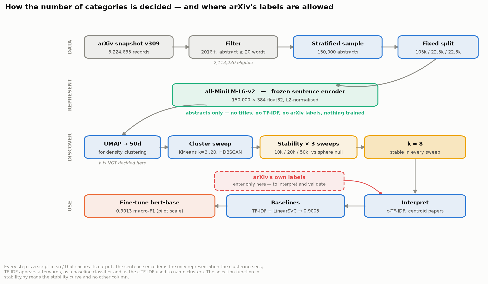
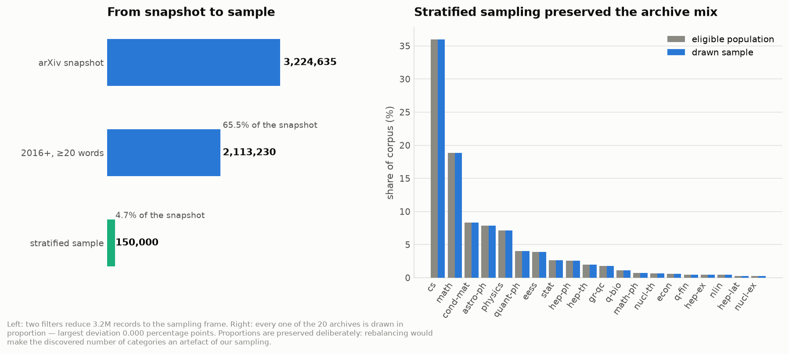

# Research Article Classification on arXiv

**How many categories are in a corpus of scientific abstracts, and can a model predict them?**

Data: the public [arXiv metadata snapshot](https://www.kaggle.com/datasets/Cornell-University/arxiv)
(Cornell University, version 309) — 3,224,635 records, 5.65 GB.

---

## Summary

The number of categories is unknown, so it is discovered rather than assumed. We encode
150,000 abstracts with a frozen sentence-transformer, cluster them, and choose the number
of categories by **reproducibility**: a value of k counts only if an independent sample of
the same corpus finds it again. Across three sweeps — 10,000, 20,000 and 50,000 abstracts —
only k = 3, 5 and 8 are stable in all three. **Eight** is the largest, and so the most
granular reproducible taxonomy. No arXiv label is used in reaching that number.

The taxonomy is structurally the inverse of arXiv's: it splits computer science into three
categories and mathematics into two, while covering thirteen physics archives with three.
One of its categories has no arXiv equivalent — **large-language-model research, 11.9% of
the corpus** — because arXiv's taxonomy predates the field. A method anchored to arXiv's
labels could not have found it.

The categories are learnable from raw text. On the 150,000-paper corpus, TF-IDF with a
linear SVM reaches **0.9005 macro-F1** on validation (105,000 train / 22,499 validation).
A fine-tuned `bert-base` reaches **0.9013** on the 10,000-paper pilot — a *different and
smaller* corpus, so the two are not directly comparable. The hyperparameter search is
implemented and was **not run**; §6 says so.

| | Section |
|---|---|
| **1** | [The problem](#1-the-problem) |
| **2** | [Approach](#2-approach) |
| **3** | [Data](#3-data) |
| **4** | [Discovering the categories](#4-discovering-the-categories) |
| **5** | [Evaluation](#5-evaluation) |
| **6** | [Hyperparameter tuning](#6-hyperparameter-tuning) |
| **7** | [Conclusions](#7-conclusions) |

[PIPELINE.md](PIPELINE.md) traces every phase with its parameters and outputs.
[PRESENTATION.md](PRESENTATION.md) is slide-by-slide speaking notes.

---

## 1. The problem

In ordinary text classification you are given the categories. Here **the number of
categories is unknown and determining it is part of the task**, which makes this two
problems: an open one (how many categories, and what are they?) and a supervised one (can
a model assign an unseen abstract?).

arXiv ships subject labels such as `cs.LG`, and the obvious shortcut is to train on them.
We do not, for three reasons:

- **Authors choose their own labels**, so they are applied inconsistently.
- **52.7%** of sampled papers carry more than one subject label and **17.3%** span more
  than one top-level group — "the" category of a paper often does not exist.
- **The taxonomy is older than parts of the field.** arXiv has no archive for
  large-language-model research. A method anchored to its labels cannot discover a
  category arXiv lacks — and §4.4 shows this corpus contains one.

### Scope

The brief admits two readings, so we asked. Iris.ai confirmed the second:

> "You're right, (b) is the better interpretation. Discovering meaningful categories is an
> important part of the objective, but we leave the exact methodology up to you."

So: categories are **discovered from the abstracts**, the classifier predicts **those**
categories, and arXiv's labels are used **only** to interpret and sanity-check.

### Three questions, three instruments

| Question | Instrument | May not be used for |
|---|---|---|
| How many categories? | Stability across independent resamples | Never uses arXiv labels |
| What are they about? | c-TF-IDF terms, centroid papers, arXiv composition | Not a score |
| Can a model assign one? | Macro-F1 on a held-out split | Only comparable within one label set |

**A classifier's macro-F1 is not evidence that a taxonomy is good** — a trivial two-category
split would score near-perfectly and mean nothing. The two are never traded against each
other (§5.3).

---

## 2. Approach



Two things to read off the diagram: the **green box** is the only representation the
clustering ever sees, and the **dashed red box** is the only place arXiv's labels enter —
pointing at interpretation, after the number has been decided.

### Three representations, three jobs

Only the first feeds the clustering:

| Representation | Where | Used for |
|---|---|---|
| **Sentence encoder** — `all-MiniLM-L6-v2`, frozen, 384d, L2-normalised | `embed.py` | **The clustering** |
| **TF-IDF** — word 1–2 grams + char 3–5 grams | `baseline.py` | A baseline *classifier* only |
| **c-TF-IDF** — cluster-level term weights | `interpret.py` | *Naming* clusters once they exist |
| **Fine-tuned BERT** | `train_classifier.py` | Learns its own representation for classification |

### The methods, and why these

**Sentence-BERT** (Reimers & Gurevych, 2019) rather than raw BERT: BERT's `[CLS]` vector
was never trained to place similar documents near each other, and clustering is entirely a
question of distances.

**KMeans and HDBSCAN together**, because they fail differently. KMeans takes k as input and
assigns everything, assuming convex clusters. HDBSCAN (Campello et al., 2013) infers its
own number and can refuse to assign. Density estimation degrades in high dimensions, so
HDBSCAN runs on a **UMAP** (McInnes et al., 2018) reduction to 50d — the recipe from
**BERTopic** (Grootendorst, 2022), whose **c-TF-IDF** we also use to name clusters.

**Stability selection** (Ben-Hur et al., 2002; Lange et al., 2004) for the number of
categories, because it needs no labels: it asks whether a grouping is reproducible, not
whether it matches a reference. Internal indices — **silhouette** (Rousseeuw, 1987) and
**DBCV** (Moulavi et al., 2014) — are computed and reported, but §4.3 shows why they cannot
decide this.

**ARI and AMI**, not raw NMI, for comparing groupings: NMI drifts upward with cluster count,
which would reward splitting while choosing k. **Macro-F1**, not accuracy, for the
classifier: the archives differ in size by 152×.

> **Three papers closest to the implementation**, as the brief asks:
> Reimers & Gurevych (2019) for the representation; Grootendorst (2022) for the discovery
> recipe and cluster naming; Lange et al. (2004) for the selection criterion.

### Related work

**Arcan (2026)** is the closest published study — it clusters arXiv papers and trains
classifiers on them, comparing four encoders and three algorithms. We adopt two of its
findings as testable choices: abstract-only input beat richer variants, and general-purpose
encoders beat science-specific ones at clustering.

**It is not the same task.** Arcan selects the number of clusters by maximising
`0.5·ARI + 0.5·NMI` **against arXiv's true labels**, conceding this "may inflate reported
ARI/NMI". That is sound when the labels are ground truth and circular when the number is
stated to be unknown. Their chosen count moves with the input representation — 6, 8, 10, 8
— with no error bars, and their 0.923 macro-F1 is measured against a different label set on
a filtered subset, so it is a reference point, not a target.

### What the data is at each step

| Step | Object | Concretely |
|---|---|---|
| Sample | `sample.parquet` | 150,000 rows: id, abstract, archive, group, split |
| Embeddings | `embeddings_minilm.npy` | **150,000 × 384** float32, unit-length rows |
| UMAP | `umap_minilm_50d.npy` | 150,000 × 50 float32 |
| Cluster sweep | `clustering_main_minilm.csv` | 23 configurations × 15 columns |
| Stability | 3 × `stability_*_n*.csv` | 18 rows each (k=3..20), mean and sd over 10 repeats |
| Labels | `labels_minilm_kmeans_k8_emb.npy` | 150,000 integers in 0..7 |
| Training bundle | `trainset_*.parquet` | 94.6 MB, sha256 `71568b1c134fef65` |

---

## 3. Data

### What the corpus looks like


Three findings shaped the design:

- **The field mix is not stationary.** Computer science grows from a minor archive to the
  largest. Sampling across all years would let the discovered categories encode *when*
  papers were written → the 2016 cutoff.
- **Median abstract is 159 words.** 256 tokens fits 67.2% of abstracts whole; 128 fits only
  20.5% → `MAX_TOKENS = 256`.
- **558,087 papers (17.3%) span more than one top-level group** → the reference taxonomy is
  soft, and every agreement score here compares a hard partition against it.


### Sampling and splitting



| Filter | Records | Why |
|---|---|---|
| arXiv snapshot v309 | 3,224,635 | — |
| Submitted 2016 or later | 2,118,113 | removes 24 legacy archive codes and the physics-dominated era |
| Abstract ≥ 20 words | **2,113,230** | drops 4,883 stubs with no topical signal |
| Stratified sample | **150,000** | 7.1% of the eligible frame |

**Stratified on primary archive, proportional — deliberately not balanced.** Balancing
would make the discovered number of categories an artefact of our sampling. The right-hand
panel is the check: every one of the 20 archives drawn in proportion, largest deviation
**0.000 percentage points**. The spread is severe — `cs` is **152×** `nucl-ex` — which is
why macro-F1 is the headline metric and why the classifier weights classes in the loss.

| Split | main | pilot |
|---|---|---|
| train | 105,000 | 7,022 |
| validation | 22,499 | 1,544 |
| test | 22,501 | 1,434 |

The split is computed **before** the clustering subset is drawn, and that subset is
train-only; `check_integrity.py` verifies 0 non-train rows in it. The 10,000-paper pilot is
drawn from the main sample and inherits its split, so no paper moves between train and test.

**Text cleaning is minimal: whitespace only, LaTeX left intact.** Stripping `\mathbb` would
delete real signal — it is one of the two strongest terms identifying the pure-mathematics
category (§4.4).

**Reproducibility.** Kaggle republishes this dataset monthly, so we pin **version 309** and
commit the sampled arXiv IDs to `data/splits/`. Everything else follows from `SEED = 42` in
`src/config.py`. Raw data and embeddings are written to `%LOCALAPPDATA%`, never into the
repository.

---

## 4. Discovering the categories

### 4.1 Representation

| | |
|---|---|
| Model | `sentence-transformers/all-MiniLM-L6-v2` (384d, max 256 tokens) |
| Input | abstract only, no title |
| Output | L2-normalised float32 |
| Throughput | 150,000 abstracts in 81.7 min on CPU |

**Frozen — nothing is trained here.** **L2-normalised**, which makes Euclidean distance
equivalent to cosine; without it KMeans would partly cluster on abstract length.

### 4.2 Candidate groupings

KMeans swept k = 3…20 on all 150,000 papers; HDBSCAN swept `min_cluster_size` from 0.2% to
4% on a 50,000-paper subsample (the full set reached 16 GB of paged memory without
progressing).

**The UMAP reduction fixes the noise collapse.** Arcan ran HDBSCAN on raw high-dimensional
vectors and reported up to **74% of papers discarded as noise**, concluding HDBSCAN
performed worst by a wide margin. With the reduction:

| | Arcan (no reduction) | main, 50k |
|---|---|---|
| Papers left as noise | up to **74%** | **0.0 – 16.8%** |
| Best ARI vs archives | 0.01 – 0.03 | **0.610** |


**But HDBSCAN's cluster count does not survive a change of scale.** The same
`min_cluster_size` *fraction* gives 12 clusters on the pilot and 3 on the main corpus at
0.5%; 7 and 2 at 1%. Neighbouring settings produce degenerate partitions with 82% in one
cluster. **HDBSCAN cannot be the instrument that answers "how many categories are there"** —
it serves as an independent check on a number chosen another way.

### 4.3 Choosing the number — the brief's central question

#### Why not silhouette


Silhouette's optimum is **k=4** (0.552) — a solution where one cluster holds **45.6% of the
corpus**. DBCV peaks at 0.716 on a **two-cluster** HDBSCAN partition holding 82%. Both
internal criteria reward a few fat, well-separated blobs. They are reported and they decide
nothing.

#### Stability

Cluster two independent 80% subsamples separately, measure ARI on the papers both saw,
repeat 10 times, take mean and standard deviation. 400 clusterings per k, 7,200 per sweep.

Two details that took three attempts to get right:

**The null.** ARI is chance-corrected, so random *labellings* score 0 — but KMeans will
carve a featureless blob the same way twice, so the null must be structureless data of the
same shape. A first attempt shuffled each coordinate independently; that preserves the
marginals, and since UMAP coordinates are multi-modal the product distribution stays
clusterable. It scored **0.9998** and selected k=16 on noise. Replaced with **points
uniform on the unit sphere**, which scores **0.005–0.008**.

**The space.** Measured inside the UMAP reduction, stability saturates — 1.000 at k=3, 17
of 18 values clearing the threshold — because `min_dist=0` manufactures separated clumps.
That measures UMAP's determinism. The number is decided in the **original embedding space**,
where 4 of 18 clear.

#### The rule: replication across sweeps


The sweep was run three times on independent samples. Each curve looks decisive alone, and
**they disagree**:

| Sweep | k whose lower bound clears 0.80 |
|---|---|
| n=10,000 | 3, 4, 5, **8** |
| n=20,000 | 3, 4, 5, 6, 7, **8** |
| n=50,000 | 3, 5, 6, 7, **8**, 9, 15, 16, 17, 18 |
| **stable in all three** | **3, 5, 8** |

Two shape-based rules were tried and discarded. "Largest k clearing the threshold" returns
**18** on the third sweep, walking past the collapse into a revival nothing else reproduces.
"Stop at the first sustained collapse" returns **5** on the pilot, whose real dip at k=6–7
reads as a cliff.

> **Rule:** the largest k whose one-standard-deviation lower bound clears 0.80 in **every**
> sweep. Strictly more conservative than any single-curve rule — it cannot select a k that
> any sweep found unstable.

> ### Answer: 8 categories
> Lower bound **0.922 / 0.946 / 0.893** across the three sweeps, against a structureless
> null of 0.005–0.008. Computed by `stability.py --consensus`, recorded in
> `reports/stability_consensus.json`.

Among reproducible taxonomies the more informative is preferred — a three-way split is easy
to reproduce and tells you little. **An independent check agrees:** HDBSCAN, a different
algorithm in a different space given no k at all, settles on 7 on the pilot.

### 4.4 The eight categories

| # | Share | Reading | Dominant archive | Distinguishing terms |
|---|---|---|---|---|
| 0 | 19.2% | Algorithms, optimisation and control | `cs` (51%) | algorithm, problem, optimization, control |
| 1 | 7.8% | High-energy theory and gravitation | `hep-ph` (30%) | theory, field, black, mass, gravity |
| 2 | 11.9% | **Language models and NLP** | `cs` (**95%**) | models, language, **llms**, reasoning |
| 3 | 10.7% | Differential equations, numerical analysis | `math` (59%) | equation, solutions, numerical, boundary |
| 4 | 11.4% | Pure mathematics and algebra | `math` (86%) | mathbb, mathcal, prove, algebra |
| 5 | 8.4% | Astrophysics | `astro-ph` (85%) | stars, galaxies, stellar, emission |
| 6 | 13.6% | Condensed matter and quantum systems | `cond-mat` (50%) | quantum, states, magnetic, spin |
| 7 | 17.0% | Machine learning and computer vision | `cs` (80%) | learning, image, training, neural |

Names are our reading of the evidence, not model output. Every paper is assigned; the
largest category holds 19.2% — no degenerate blob. The structure **replicates**: the pilot,
clustered independently at a fifteenth of the scale, produces the same eight-way split.


#### This is not arXiv's taxonomy, and that is the point

**It splits what arXiv merges.** All of computer science is one arXiv archive; the data
divides it into three categories sharing almost no vocabulary — optimisation (0), language
models (2), vision and deep learning (7) — together 48% of the corpus. Mathematics splits
along the applied/pure line.

**It merges what arXiv splits.** Thirteen physics archives are covered by three categories,
grouping `hep-ph` with `hep-th` and `gr-qc` because those papers share a vocabulary.


**Category 2 is one arXiv does not have.** Top terms `llms`, `language`, `reasoning`, 94.6%
computer science. arXiv's taxonomy predates the field, so this work is filed under general
`cs` beside operating systems and computational geometry. The method recovered it twice,
independently, at two scales.

#### Better taxonomies can score *worse* against the reference

| Reference level | Homogeneity | Completeness | V-measure |
|---|---|---|---|
| 20 archives | 0.469 | 0.490 | 0.479 |
| 8 groups | 0.526 | 0.357 | 0.425 |

Splitting `cs` into three necessarily lowers completeness, because a reference that keeps
`cs` whole counts every split as an error. The undivided 7-cluster HDBSCAN solution scores
*higher* (0.75) precisely because it leaves a blob holding 43% of the corpus intact.
Agreement measures similarity to arXiv, not quality — which is why the number was settled
by stability.

---

## 5. Evaluation

### 5.1 The taxonomy

A clustering has no labels to hold out, so the equivalent of held-out evaluation is
resampling.

| Question | Instrument | Result |
|---|---|---|
| Is it reproducible? | ARI between independent subsamples, three sweeps | **0.922 / 0.946 / 0.893** at k=8 |
| Does it replicate? | k stable in *every* sweep | **3, 5, 8** |
| Better than nothing? | the same, on structureless data | null **0.005–0.008** |
| Is it balanced? | largest category's share | **19.2%** |
| Does it cover the data? | papers assigned | **100%** |
| Is it readable? | c-TF-IDF terms, centroid papers | §4.4 |

### 5.2 The classifier

Train on the training split, select on validation, read the test split once.

Baselines on the 150,000-paper corpus:

| Model | What it uses | Validation macro-F1 | Accuracy |
|---|---|---|---|
| Majority class | nothing | 0.0404 | 0.1929 |
| **TF-IDF + LinearSVC** | word 1–2 grams, char 3–5 grams | **0.9005** | 0.8971 |

The first row is the argument for macro-F1 in one line: 19.3% accuracy, 0.0404 macro-F1.

`baseline.py` also fits logistic regression on the frozen embeddings. That number is
**not reported as a result**, because it cannot be one: a KMeans partition is a Voronoi
tessellation of the embedding space, so a linear model in that same space recovers it
almost perfectly by construction. It measures how cleanly the clustering cut the space,
not whether the categories can be recovered from text. Only TF-IDF and the transformer
answer that.

**0.9005 is the number to beat, and it is demanding** — the eight categories are already
largely separable by vocabulary alone, which is itself evidence they are coherent.

Classifier results are in §6.3.

### 5.3 Why the two scores are never traded

A classifier's macro-F1 is not evidence a taxonomy is good, for three reasons:

1. **Circularity** — discovered labels come from the embeddings, so a model reading those
   embeddings partly marks its own homework.
2. **Granularity** — coarser categories are easier to predict; a one-category taxonomy
   scores perfectly and conveys nothing.
3. **Asymmetric label noise** — over half of arXiv papers carry multiple labels, so a
   "wrong" prediction against arXiv often is not. The two tasks have different ceilings.

**Classifier metrics are comparable only between runs sharing one label set.** This also
rules out comparing our macro-F1 with Arcan's 0.923, which is measured against different
labels on a different subset.

---

## 6. Hyperparameter tuning

### 6.1 Two searches, both implemented

```bash
python src/tune.py --labels kmeans_k8_emb --search staged --dry-run  #  10 distinct runs
python src/tune.py --labels kmeans_k8_emb --search grid   --dry-run  # 108 runs
```

**Staged** resolves one factor at a time and carries the winner forward — learning rate
(4 values), then batch size, then encoder, then a three-seed spread — giving the same
decisions in 10 runs instead of 108. **Grid** is the full Cartesian product, making no
separability assumption, so learning-rate × batch-size interactions are measured rather
than assumed away. Both share the runner, the validation-macro-F1 selection and the outputs.

Stage 4 is not tuning: it re-runs the winner under three seeds so the headline carries a
spread. A single fine-tuning run is not a measurement.

**Selection uses validation macro-F1 only.** The test split is scored once per run and
reported, never compared during the search.

### 6.2 Hyperparameters used

lr **2e-5**, batch **16**, **3 epochs**, 256 tokens, AdamW, weight decay 0.01,
class-weighted loss, early stopping patience 2. These are the fine-tuning defaults
recommended in the BERT paper (Devlin et al., 2019, Appendix A.3), and they lie inside the
Optuna search space Arcan used — though that paper reports its search space and **never the
values it selected**, so the configurations cannot be matched exactly.

We differ deliberately on sequence length: **256 tokens against their 128**, because 256
fits 67.2% of abstracts whole and 128 fits 20.5% (§3).

### 6.3 Results

**Neither search has been run.** Both need a GPU: a full-scale run is roughly 52 CPU-hours,
so the staged search is about three weeks on this machine and the grid far longer.

What was run is **one configuration at pilot scale**, so that this section reports a
measured transformer number rather than a projection:

| Model | Corpus | val macro-F1 | test macro-F1 |
|---|---|---|---|
| tf-idf + LinearSVC | pilot (7,022 train) | 0.8834 | 0.8780 |
| **`bert-base-uncased`, fine-tuned** | pilot (7,022 train) | **0.9013** | **0.9008** |

349.5 minutes on CPU. Per-epoch validation macro-F1: 0.8539 → 0.8954 → 0.9013, so the run
converged. Per-class F1 runs 0.86–0.96 — **no category collapses** — and macro and weighted
scores sit within 0.004, so the class weighting worked.


**The errors are concentrated where the taxonomy is genuinely soft.** The three
computer-science-derived categories trade mistakes among themselves: 8% of language-model
papers and 8% of deep-learning papers are predicted as algorithms/optimisation. Astrophysics
is cleanest at 97%. This mirrors the clustering — the cs/ML region is one dense mass that
k=8 cuts into three, and the classifier inherits those boundaries.

**What this does and does not establish.** It establishes that the discovered categories are
recoverable from raw text at about 0.90 macro-F1 — the taxonomy is learnable, not an
artefact of the embedding space it was built in. It does **not** establish that BERT beats
TF-IDF in general: +1.8 points from one seed at pilot scale is within the range a seed
change could move. And it replaces none of the search.

---

## 7. Conclusions

### 7.1 The answer

**Eight categories.** The largest k that every one of three independent sweeps found
reproducible, against a structureless null two orders of magnitude below. No arXiv label was
consulted. The categories are listed in §4.4; every paper is assigned, the largest holds
19.2%, and each is interpretable from its vocabulary.

### 7.2 What we did not expect

**The discovered taxonomy is the structural inverse of arXiv's** — three categories for
computer science and two for mathematics, three for thirteen physics archives. Neither is
wrong: arXiv's reflects how communities organised historically, ours reflects what abstracts
say now.

**One category has no arXiv equivalent** — large language models, 11.9% of the corpus, found
twice at two scales. This is the result that justifies the exercise: a classifier trained on
arXiv's labels could never have found it, and no agreement score would have revealed it,
because agreement with arXiv *penalises* discovering a category arXiv lacks.

### 7.3 Predictions, scored

| | Prediction | Outcome |
|---|---|---|
| **H1** | Silhouette and stability will disagree; prefer stability | **Confirmed.** Silhouette peaks at k=4 with 45.6% in one cluster; DBCV at 2 clusters with 82%. |
| **H2** | HDBSCAN after UMAP will not show Arcan's collapse | **Partly.** Noise fixed (74% → ≤17%), ARI improved (0.03 → 0.61). But the cluster count is unstable across corpus size. |
| **H3** | Categories will not line up with arXiv's 8 groups | **Confirmed**, more strongly than expected — §7.2. |
| **H4** | The 8 groups will favour fewer categories than the 20 archives | **Confirmed on the pilot**; at 150k both peak early, so the gap narrows. |
| **H5** | Fine-tuned BERT will beat TF-IDF + LinearSVC | **Weakly supported.** 0.9013 vs 0.8834 on the pilot — a win of 1.8 points from one seed. The seed spread that would make it a measurement was not run. |

### 7.4 What we got wrong

Four errors, each of which changed a result and none visible from the final numbers.

**A null model that was not null.** Shuffling each embedding coordinate independently
preserves every marginal while destroying the joint structure — which sounds right and is
wrong here, because the coordinates are multi-modal so the product distribution stays
clusterable. It scored 0.9998 and selected k=16 on noise. Replaced with uniform points on
the unit sphere (0.007).

**Measuring in a space that cannot discriminate.** Inside UMAP, 17 of 18 candidates clear
the threshold and the rule returns the sweep's upper limit. `min_dist=0` manufactures
separated clumps, so what is measured is UMAP's determinism. The number is decided in the
embedding space.

**Over-reading the pilot, twice.** (a) The pilot's HDBSCAN result was read as evidence that
UMAP turns HDBSCAN from worst algorithm to best; the cluster counts do not hold at scale,
though the noise fix does. (b) The pilot showed k=6 and k=7 as *unstable*, making k=8 look
like an island between noisy neighbours — a tidy story that did not replicate.

**A selection rule that read one curve's shape.** The number was first chosen by taking the
largest k clearing the threshold in a single sweep, which showed a plateau from k=3 to k=8
and a clean cliff at k=9 — and this report described that as "what a well-behaved stability
curve looks like". Re-running at 50,000 abstracts broke it: stability revives to 0.93 at
k=17 and the rule returned **18**. The obvious repair returned **5** on the pilot. Both were
discarded for replication across sweeps, which gives 8 without depending on any curve's
shape.

The pattern is consistent enough to state as a finding: **on this corpus, any claim resting
on the shape of one curve should be assumed unreplicated until checked.**

### 7.5 Limitations

**Granularity is genuinely ambiguous.** k = 3, 5 and 8 are all reproducible. Eight is
defensible as the most granular; a coarser taxonomy is also supportable.

**The stability curve is noisier than one sweep suggests.** The three sweeps agree on 3, 5
and 8 and disagree about everything else, including where the collapse begins. Ten
repetitions separated signal from null by two orders of magnitude but did not pin the
curve's shape.

**The reference taxonomy is not ground truth.** Over half of papers carry multiple labels.

**Clustering saw the whole sample.** KMeans was fitted on all 150,000, so validation and
test abstracts contributed to defining the categories the classifier is scored on. The split
was still fixed first, and a train-only clustering subset is reserved and verified for the
robustness check — which was not run.

**One encoder, one corpus slice.** `all-MiniLM-L6-v2` on papers from 2016 onward. MPNet is
implemented but was not run at scale. The taxonomy describes contemporary research: the
language-models category would not appear in a 1990s corpus.

**HDBSCAN was swept on 50,000 papers**, not 150,000, which exhausted memory.

**The hyperparameter search was not run** (§6.3), and the transformer number is one
configuration at pilot scale.

---

## Reproducing

```bash
python -m venv .venv && .venv/Scripts/activate      # Unix: source .venv/bin/activate
pip install -r requirements.txt
export KAGGLE_API_TOKEN=...                          # Windows: $env:KAGGLE_API_TOKEN="..."
python src/download_data.py
```

Every step caches its output and skips unless `--force` is passed.

```bash
python src/eda_scan.py
python src/eda_year_mix.py
python src/preprocess.py

python src/embed.py      --phase main --model minilm
python src/cluster.py    --phase main --model minilm
python src/stability.py  --phase main --model minilm --space embedding --max-n 50000 --skip-hdbscan
python src/stability.py  --consensus
python src/interpret.py  --phase main --model minilm --algorithm kmeans --k 8
python src/baseline.py   --phase main --embed-model minilm --labels kmeans_k8_emb

python src/check_integrity.py --phase both
python src/figures.py    --phase main --model minilm --labels kmeans_k8_emb
```

`--labels` and `--embed-model` default to the pilot's HDBSCAN configuration, which is not
what this report uses — pass `kmeans_k8_emb` explicitly.

Fine-tuning runs on a GPU. Export the bundle, then run `notebooks/colab_train.ipynb`:

```bash
python src/export_training_set.py --phase main --embed-model minilm --labels kmeans_k8_emb
```

### Repository

```
src/          config, download, EDA, preprocess, embed, cluster, stability,
              interpret, baseline, train_classifier, tune, figures, check_integrity
reports/      metrics as JSON/CSV, cluster profiles, figures
data/splits/  committed arXiv IDs pinning the exact sample
notebooks/    colab_train.ipynb — the same search on a T4
```
