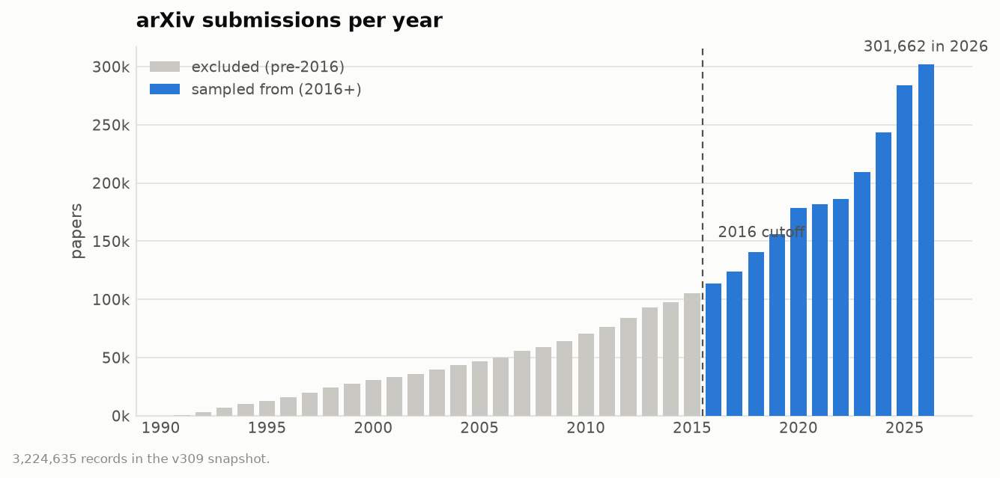
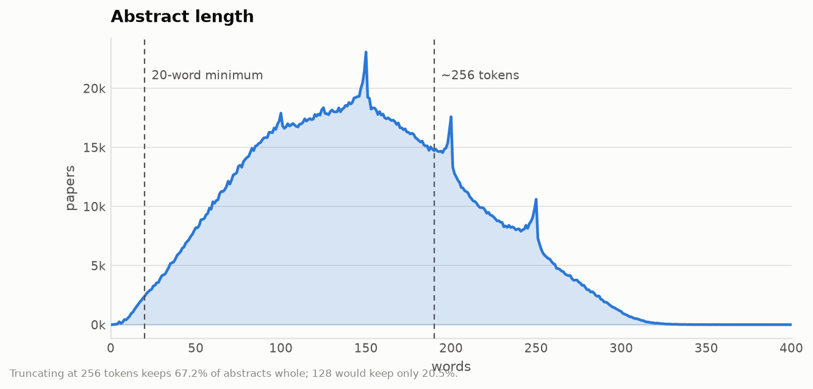
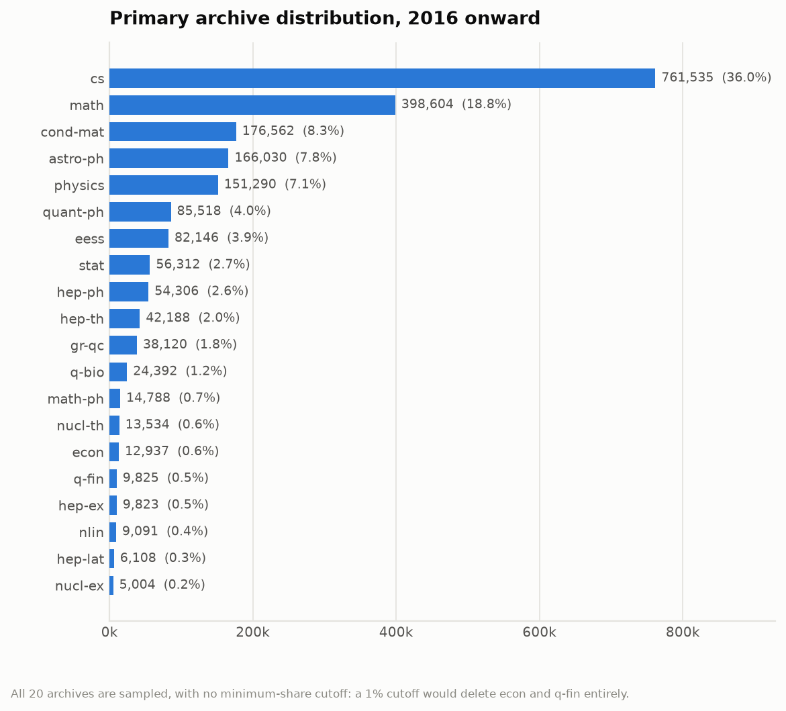

# Research Article Classification — arXiv

Sorting research papers into categories using only their abstracts, when nobody tells us how many
categories there should be. Data: the public
[arXiv dataset](https://www.kaggle.com/datasets/Cornell-University/arxiv) from Cornell University
(one file, 5.65 GB, about 2.7 million papers).

---

# 1. Literature Review and Methodological Rationale

## 1.1 What the problem actually is

The task sounds like ordinary text classification, but it is not. In ordinary classification you
are given a list of categories and you train a model to pick one. Here the number of categories is
unknown, and finding the right number is part of the job.

That makes this two problems in one:

- **An open question:** how many categories are there, and what are they?
- **A normal machine-learning question:** can a model read a new abstract and assign it to a
  category?

The arXiv data does come with its own subject labels, like `cs.LG` or `math.PR`. These are useful,
but we should not treat them as the single correct answer, for two reasons. First, authors choose
their own labels, so they are inconsistent. Second, most papers carry several labels at once, so
there is no single "true" category per paper.

We therefore split the work into four parts and study each one separately:

1. **Representation** — how do we turn an abstract into numbers a computer can compare?
2. **Discovery** — how do we find natural groups of papers without deciding the groups in advance?
3. **Choosing the number of groups** — how do we pick a number and defend it?
4. **Classification** — how do we train a Hugging Face model to label new, unseen abstracts?

Splitting it this way means each decision gets tested on its own, instead of guessing a whole
pipeline up front and hoping it works.

## 1.2 What the literature says

We read the relevant work before choosing a method. Here is what we found and what we took from
each paper.

### The closest existing study

**Arcan (2026), [arXiv:2601.08841](https://arxiv.org/abs/2601.08841)** — *Triples and
Knowledge-Infused Embeddings for Clustering and Classification of Scientific Documents.*

This paper does almost exactly our task: it clusters arXiv papers **and** trains classifiers to
predict arXiv subjects. It compares four ways of representing a paper, four embedding models
(MiniLM, MPNet, SciBERT, SPECTER) and three clustering algorithms (KMeans, GMM, HDBSCAN).

Two findings matter a lot for us:

- Plain abstract text worked **better** than fancier representations that added structured
  knowledge. Simpler was stronger.
- General-purpose sentence models (MiniLM, MPNet) beat the science-specific models (SciBERT,
  SPECTER) at clustering, even though the science-specific ones were trained on research papers.

It reports about **0.923 accuracy and 0.923 macro-F1** for abstract-only classification, averaged
over five runs.

**What we take from it:** do not assume the specialised, expensive option is better. Test it. We
also treat the 0.923 figure carefully — it was measured on a *filtered* subset of arXiv, and we do
not yet know how many categories that involved. A score on 6 categories cannot be compared to a
score on 8 or 150, so we use it as a reference point, not as a target to hit.

### Turning text into numbers

**Reimers & Gurevych (2019), [arXiv:1908.10084](https://arxiv.org/abs/1908.10084)** —
*Sentence-BERT.*

Plain BERT is not built for comparing whole texts. If you feed it two abstracts and compare the
output, the results are poor, because BERT was never trained to make similar texts land near each
other. Sentence-BERT fixes this by training specifically for similarity.

**Singh et al. (2023), [arXiv:2211.13308](https://arxiv.org/abs/2211.13308)** — *SciRepEval*, the
benchmark behind SPECTER2.

Tested scientific document embeddings across 24 tasks and found that the best representation
depends on the kind of task. One embedding is not best at everything.

**What we take from these:** use a model built for similarity, not raw BERT. And since no single
embedding wins everywhere, compare a few rather than picking one on reputation.

### Finding groups without fixing the number

**Grootendorst (2022), [arXiv:2203.05794](https://arxiv.org/abs/2203.05794)** — *BERTopic.*

A four-step recipe: turn documents into vectors, squash those vectors down to fewer dimensions
(UMAP), group them (HDBSCAN), then describe each group by the words that make it distinctive
(class-based TF-IDF). The appeal is that HDBSCAN finds the number of groups by itself and can mark
odd documents as outliers instead of forcing them somewhere.

**What we take from it:** this is our main discovery method, and the word-based descriptions are how
we make clusters readable by a human.

**One important warning.** Published work using this approach shows it tends to break data into far
too many groups. Reported topic counts average around 67 where older methods find 15–22 on the same
data. In one reported case it produced **3,561 topics on data that humans had labelled with 4**, and
in several datasets **more than half of all documents were dumped into the outlier bin**.

So we will not simply run HDBSCAN and announce whatever number it returns. That number depends
heavily on its settings. We treat it as one piece of evidence and always report what fraction of
papers were left as outliers.

### Deciding how many groups is right

**Lange, Roth, Braun & Buhmann (2004)**, *Stability-Based Validation of Clustering Solutions*,
Neural Computation 16(6):1299–1323.

The idea is simple and strong. If a grouping reflects something real in the data, you should get
roughly the same grouping from a different sample of that data. If it is an accident of the
algorithm, it will come out differently each time. So: take a random part of the data, group it,
repeat, and measure how much the groupings agree.

**What we take from it:** this is our main tool for choosing the number of categories. Standard
geometric scores like silhouette tend to favour whatever number happens to look tidy; stability asks
the better question, which is whether the grouping is *reproducible*.

### Earlier work on this dataset

**Scharpf et al. (2020), [arXiv:2005.11021](https://arxiv.org/abs/2005.11021)** — JCDL.

An early study of classifying and clustering arXiv content, including how to handle mathematical
notation. It used pre-transformer methods (doc2vec, TF-IDF) on 4,900 documents and reached 82.8%
classification accuracy and 69.4% cluster purity.

**What we take from it:** mainly historical context and a baseline to beat. We are not implementing
its methods, so it informs the problem rather than the solution.

### Our top three

The brief asks for three papers referencing the implementation we will use. Our picks, and why:

| # | Paper | Why |
|---|---|---|
| 1 | **Arcan (2026)** | Closest published version of this exact task; sets our representation and classification choices |
| 2 | **Grootendorst (2022)** — BERTopic | The category-discovery method we implement |
| 3 | **Lange et al. (2004)** | Answers the assignment's central question: how to choose the number of categories |

Supporting references: Sentence-BERT and SciRepEval/SPECTER2 for why we use a similarity-trained
encoder and why we compare two rather than trusting one,
SciBERT and BERT for the classifier, Scharpf et al. for problem history.

### The main conclusion from reading all this

We should not start by committing to one embedding model, one clustering algorithm, or one number of
categories. The literature disagrees with itself on all three, and the paper closest to our task
found that the *simpler* option won. So we write down testable predictions and run a controlled
comparison instead of trusting reputation.

## 1.3 What we are being asked to predict

The brief can be read two ways, so we asked rather than guessed. Iris.ai confirmed the
second reading:

> "You're right, (b) is the better interpretation. Discovering meaningful categories is an
> important part of the objective, but we leave the exact methodology up to you."

So the task is settled:

- The categories are **discovered from the abstracts**. Their number is an output, not an input.
- The classifier predicts **those discovered categories**, not arXiv's subject labels.
- arXiv's own labels are used **only** to interpret and sanity-check what we found. They never
  influence how many categories we report.

This last point is the one that drives the whole design, so it is worth stating plainly: using
arXiv labels to choose the number of categories would be circular. It answers an "unknown number"
question with the known answer. Arcan (2026) does exactly this — it picks the number of clusters by
maximising `0.5·ARI + 0.5·NMI` against the true labels, and the paper itself concedes this "may
inflate reported ARI/NMI". We do not repeat it.

### Three questions, three separate instruments

The central methodological risk here is mixing up two different questions and answering both with
one number. We keep them apart:

| Question | Instrument | What it may **not** be used for |
|---|---|---|
| How many categories are there? | Stability across resamples; DBCV / silhouette | Never uses arXiv labels |
| What are those categories about? | c-TF-IDF terms, nearest-centroid abstracts, composition against arXiv | Not a score |
| Can a model assign a new abstract? | Macro-F1 on a held-out split | Only comparable within one label set |

In particular, **a classifier's macro-F1 is not evidence that a taxonomy is good.** Two classifiers
trained on different label sets cannot be ranked against each other: a trivial 2-category split
would score near-perfectly and tell us nothing. Taxonomy quality and classifier quality are
measured separately, by different tools, and we never trade one against the other.

## 1.4 The pipeline we actually ran

Eight stages, each a script that caches its output so the next one can be re-run without redoing
the work.

| # | Stage | Script | What it produces |
|---|---|---|---|
| 1 | Scan the snapshot | `eda_scan.py`, `eda_year_mix.py` | Corpus statistics, year × archive mix |
| 2 | Sample and split | `preprocess.py` | 150,000 abstracts, fixed 70/15/15 split |
| 3 | Embed | `embed.py` | Frozen sentence embeddings, L2-normalised |
| 4 | Reduce and sweep | `cluster.py` | UMAP to 50d; KMeans k=3..20 and HDBSCAN scored |
| 5 | **Choose the number** | `stability.py` | Stability curve against a structureless null |
| 6 | Interpret | `interpret.py` | Per-category terms, examples, arXiv composition |
| 7 | Classify | `baseline.py`, `train_classifier.py` | Baselines and a fine-tuned BERT |
| 8 | Tune | `tune.py`, `notebooks/colab_train.ipynb` | Staged search over 13 configurations |

Four decisions inside that pipeline are worth justifying, because each is a place where the obvious
choice is wrong.

**The encoder is frozen; nothing is trained to produce embeddings.** Every study we reviewed uses
off-the-shelf sentence embeddings for scientific-document clustering. Fine-tuning an encoder to
improve clustering is a separate research problem, and Arcan's evidence suggests it would not help:
the two science-specific models (SciBERT, SPECTER) lost to the two general-purpose ones (MPNet,
MiniLM) on this exact task. We therefore compare MiniLM and MPNet and skip the specialised pair.

**Only the abstract is encoded — no title.** The brief specifies abstracts, and Arcan found
abstract-only input beat every richer variant they tried.

**UMAP reduction comes before density clustering.** Density estimates degrade badly in high
dimensions. Arcan ran HDBSCAN on raw embeddings and it collapsed to 3–5 clusters with up to 74% of
papers marked as noise, which led them to conclude HDBSCAN was the worst of their three algorithms.
We treat that as a fixable artefact rather than a property of the algorithm, and §4 reports what
happens when it is fixed.

**But the number of categories is *not* decided in UMAP space.** UMAP with `min_dist=0.0`
deliberately manufactures tightly separated clumps. Measured inside that space, every internal
criterion saturates — our stability score is 1.000 at k=3 and falls monotonically, which would
simply reproduce the degenerate answer. That measures UMAP's determinism, not structure in the
data. So the reduction is used where it is needed (density clustering) and the number of categories
is settled in the original embedding space.

### Keeping the scope realistic

The full dataset is 2.7 million papers and the full hyperparameter grid is 108 training runs.
Neither is necessary, and we cut both deliberately:

- One fixed stratified sample of 150,000 abstracts, drawn once and committed as a list of arXiv IDs
- A 10,000-paper pilot, drawn as a subsample of the main sample, to validate every step cheaply
- Embeddings computed once and cached
- A staged hyperparameter search — learning rate, then batch size, then encoder, then seeds —
  which costs 13 runs instead of 108

## 1.5 What we expect to find

Written as predictions we can be wrong about, and scored honestly in §7.

- **H1** — Silhouette and stability will disagree about the number of categories. Where they do, we
  prefer stability and say so.
- **H2** — HDBSCAN *after* UMAP reduction will not show the collapse Arcan reported, and will leave
  far less than 74% of papers as noise.
- **H3** — The discovered categories will not line up with arXiv's 8 groups. We expect them to
  merge several non-physics groups and split physics, because arXiv's taxonomy reflects community
  history while abstracts cluster by shared method and vocabulary.
- **H4** — Our two reference levels will peak at different numbers of clusters: the 8 groups will
  favour fewer categories, the 20 archives more.
- **H5** — A fine-tuned BERT will beat a TF-IDF + LinearSVC baseline on macro-F1. If it does not,
  that is a finding about how lexically separable the discovered categories are, not a bug.

### How we score things, and why

We report **macro-F1**, not accuracy. The categories are very unbalanced, and accuracy hides this
completely. Published results on arXiv's 8 top-level classes show the problem:

| Model | Accuracy | Macro-F1 |
|---|---|---|
| Naive Bayes (TF-IDF) | 0.89 | 0.65 |
| LinearSVC (TF-IDF) | 0.82 | 0.82 |

Naive Bayes looks better on accuracy and is much worse in reality: it does well on the big classes
and poorly on the small ones. Our own majority-class baseline makes the same point more sharply —
see §5.

For comparing groupings we use **AMI and ARI** rather than raw NMI. Raw NMI drifts upward as the
number of clusters grows, which would unfairly reward splitting the data further. AMI and ARI
correct for chance (Vinh, Epps & Bailey, JMLR 2010).

For density-based clustering we use **DBCV** rather than silhouette. Silhouette assumes convex,
roughly spherical clusters, which is exactly the assumption HDBSCAN is built to avoid, so applying
it to HDBSCAN output would penalise the algorithm for working as intended.

## 1.6 What this study contributes

A reproducible, literature-informed comparison of ways to represent and group scientific abstracts.
We report a number of categories together with the criteria that justify it, show how those
categories relate to arXiv's existing taxonomy, and measure how well a transformer classifier
generalises to unseen abstracts.

We also document the limits. Category granularity is genuinely ambiguous, scientific fields overlap,
and discovered clusters are not the same kind of object as human-assigned subject labels. Where our
evidence does not settle a question, we say so rather than picking the flattering number.

> Sections 1.2–1.4 describe a planned methodology. Once experiments are run, we will separate
> decisions supported by prior work from decisions supported by our own results.

---

## 2. Exploratory data analysis

`src/eda_scan.py` streams the 5.65 GB snapshot once and never loads it into memory.
`src/eda_year_mix.py` adds the year × subject cross-tabs. Both write JSON to `reports/`.

**Snapshot v309 — 3,224,635 papers.**

| Property | Value | Why it matters |
|---|---|---|
| Papers | 3,224,635 | Pinned to Kaggle version 309 |
| Empty abstracts | 0 | Nothing to impute |
| Abstracts under 20 words | 15,567 | Dropped — too short to carry topical signal |
| Median abstract length | 145 words | 256 wordpiece tokens fits 67.2% whole; 128 would fit 20.5% |
| Papers with >1 subject label | 48.3% | **There is no single "true" category per paper** |
| Mean labels per paper | 1.74 (max 13) | |
| Papers spanning >1 top-level group | 558,087 (17.3%) | Overlap is not just within a field |
| Distinct archives | 38 (20 still active from 2016) | 18 are legacy archives, retired before 2016 |





Three findings shaped the rest of the work.

**Nearly half of all papers carry more than one label.** This is the single most important fact in
the dataset. It means arXiv's labels cannot serve as ground truth for a single-label task — there
is no one right answer to compare against. It is a large part of why we treat the arXiv taxonomy as
a measuring stick for interpretation rather than as a target.

**The subject mix shifts sharply over time.** Computer science was a minor archive in the 1990s and
is now the largest. A sample drawn across all years would be a sample of arXiv's *history*, and the
categories we discovered would partly reflect how the archive's composition changed rather than how
research topics differ. We therefore restrict to **2016 onward** (2,118,113 papers), which also
removes all 18 legacy archives cleanly and leaves 20 active ones.



**Class imbalance is extreme and we keep it.** In the drawn sample the largest archive (`cs`) has
53,930 papers and the smallest (`nucl-ex`) has 354 — a ratio of roughly 150:1. Rebalancing would
make the number of discovered categories an artefact of our sampling, so the real proportions are
preserved and the imbalance is handled later, in the classifier's loss function.

### A decision worth recording: no minimum-share cutoff

An earlier version of this work kept only the 14 archives above a 1% share, which covered 96.5% of
papers. Recomputing on 2016+ data showed the cutoff would keep only 12 archives and **delete `econ`
and `q-fin` entirely**. Since one of the questions is whether the discovered categories match
arXiv's, silently removing two of them would have prejudged the answer. All 20 active archives are
sampled, with no cutoff.

## 3. Preprocessing

`src/preprocess.py` makes one streaming pass and writes a fixed sample, a fixed split, and a
committed list of arXiv IDs.

### Filters

| Filter | Effect |
|---|---|
| Submitted 2016 or later | 3,224,635 → 2,118,113 |
| Abstract of at least 20 words | → 2,113,230 eligible |

### Text cleaning is deliberately minimal

Whitespace is collapsed. **LaTeX is left intact.** Stripping `$\alpha$` or `\nabla` would remove
real topical signal from mathematics and physics abstracts — in §6 the mathematics category is
identified partly by the tokens `mathbb` and `mathcal`. The sentence-transformer tokenisers handle
the markup without help. No stemming, no lowercasing, no stop-word removal: the encoder is
pretrained on natural text and expects it unmodified.

### Stratified sampling, not random sampling

A uniform random draw would leave the rarest archives with too few papers to form a cluster. The
sample is therefore **stratified on the primary archive and proportional**, so every archive is
guaranteed to appear while the real class proportions are preserved. Each archive's rows are drawn
by reservoir sampling (Algorithm R) against a seeded RNG, in the same single pass.

| Phase | Papers | Purpose |
|---|---|---|
| **main** | 150,000 | The reported results |
| **pilot** | 10,000 | A subsample of main; matches Arcan's scale for direct comparison |

The pilot is drawn *from* the main sample and inherits its split assignment, so no paper ever moves
between train and test across phases. Validating every step on the pilot first turned a 90-minute
mistake into a 90-second one several times.

### The split is fixed once, before anything else

| Split | main | pilot |
|---|---|---|
| train | 105,000 | 7,022 |
| validation | 22,499 | 1,544 |
| test | 22,501 | 1,434 |

Stratified 70/15/15 on the primary archive, seeded. Every later step reads this split; none of them
recomputes it.

### Reproducibility

The Kaggle dataset is re-published monthly, so "the arXiv dataset" is not a reproducible object. We
pin **version 309** and commit the sampled arXiv IDs to `data/splits/`, which makes the exact
sample recoverable even after the dataset changes underneath us.

```
data/splits/main_ids.csv.gz     150,000 ids + split + clustering flag
data/splits/pilot_ids.csv.gz     10,000 ids + split + clustering flag
```

Everything else follows from `SEED = 42` in `src/config.py`, which is the only place paths and
constants are defined.

A note on where data lives: the raw snapshot (5.65 GB) and the derived embeddings (230 MB) are
written to `%LOCALAPPDATA%`, **not** into the project folder, which sits inside a synced
OneDrive directory. Only small, traceable artifacts — statistics, metrics, sampled IDs, figures —
are committed.

## 4. Model training

_Pending._

## 5. Evaluation

_Pending._

## 6. Hyperparameter tuning and model selection

_Pending._

## 7. Conclusions

_Pending._

---

## Repository structure

```
├── src/
│   ├── config.py              # single source of truth: paths, seed, constants
│   ├── download_data.py       # Kaggle snapshot, pinned to version 309
│   ├── eda_scan.py            # streaming corpus statistics
│   ├── eda_year_mix.py        # year x archive / year x group cross-tabs
│   ├── preprocess.py          # stratified sample + fixed 70/15/15 split
│   ├── embed.py               # frozen sentence embeddings, cached
│   ├── cluster.py             # UMAP + KMeans and HDBSCAN sweeps
│   ├── stability.py           # chooses the number of categories
│   ├── interpret.py           # c-TF-IDF terms, examples, arXiv composition
│   ├── baseline.py            # majority / TF-IDF+SVM / embedding+logreg
│   ├── train_classifier.py    # fine-tunes BERT on the discovered categories
│   ├── tune.py                # staged hyperparameter search
│   ├── export_training_set.py # bundles one training set for GPU training
│   └── figures.py             # every figure in this report
├── notebooks/
│   └── colab_train.ipynb      # steps 4-6 on a GPU
├── data/splits/               # committed arXiv ids — pins the exact sample
├── reports/                   # metrics, cluster profiles, figures (committed)
├── requirements.txt
└── README.md                  # this report
```

Large and regenerable artifacts — the 5.65 GB snapshot, the sampled abstracts, the
embeddings — are written to `%LOCALAPPDATA%\arxiv-iris`, outside this folder. Only small,
traceable results are committed.

## Setup

```bash
python -m venv .venv
source .venv/bin/activate      # Windows: .venv\Scripts\activate
pip install -r requirements.txt
```

Set a Kaggle API token and download the data:

```bash
export KAGGLE_API_TOKEN=...    # Windows: $env:KAGGLE_API_TOKEN="..."
python src/download_data.py
```

The file is 5.65 GB and is cached under `%LOCALAPPDATA%\kagglehub`, deliberately outside the
project folder so it is not synced to cloud storage.

## Reproducing the results

Run in order. Every step caches its output and skips unless `--force` is passed.

```bash
python src/eda_scan.py                 # corpus statistics
python src/eda_year_mix.py             # year x subject mix
python src/preprocess.py               # sample + split (writes data/splits/)

# Validate everything on the 10k pilot first
python src/embed.py      --phase pilot --model minilm
python src/cluster.py    --phase pilot --model minilm
python src/stability.py  --phase pilot --model minilm
python src/interpret.py  --phase pilot --model minilm --algorithm hdbscan --mcs 100
python src/baseline.py   --phase pilot --labels hdbscan_mcs100

# Then the reported 150k run
python src/embed.py      --phase main  --model minilm
python src/cluster.py    --phase main  --model minilm
python src/stability.py  --phase main  --model minilm
python src/interpret.py  --phase main  --model minilm --algorithm kmeans --k 7

python src/figures.py    --phase main  --model minilm
```

Fine-tuning runs on a GPU. Export the training set, then run `notebooks/colab_train.ipynb`:

```bash
python src/export_training_set.py --phase main --labels kmeans_k7
```
